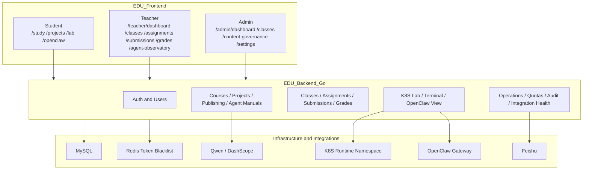

# Product Structure and Modules

Agent EDU Lab has evolved from an early demo into a three-portal training platform. The current product structure is centered on the React frontend, Go backend, K8S Classic Lab, independent OpenClaw scenarios, and operations governance.

## Current Architecture



## Nine Core Modules

| Module | Users | Current Capability |
| --- | --- | --- |
| Learning Center | Students | Courses, class courses, assignments, notifications, learning overview |
| Lessons | Students | Markdown / PDF / Word reading, lesson records, Agent assistance |
| Classic Lab | Students | K8S Pod / Service, noVNC, Web terminal, command execution and validation |
| Projects | Students | Normal project units, project labs, OpenClaw routing |
| OpenClaw | Students | Independent phase walkthrough, Feishu / Gateway messages, artifacts |
| Teacher Content Production | Teachers | Courses, projects, Agent manuals, publish checks, student preview |
| Assignments and Grading | Teachers / Students | Assignment publishing, submissions, evidence snapshots, grading, returns, grade release |
| Agent Observatory | Teachers | Step heatmaps, blockers, chats, terminal evidence, FAQs, interventions |
| Operations Governance | Admins | K8S sessions, quotas, audit logs, integration health, AI settings |

## Student Flow

```text
/study
→ View courses, classes, assignments, notifications, and learning overview
→ Enter a lesson or project unit
→ Read materials and open the Agent manual
→ Use Classic Lab for normal labs
→ Use /openclaw/* for OpenClaw projects
→ Complete validations and submit assignments
→ View teacher feedback, grades, and revision requests
```

## Teacher Flow

```text
/teacher/dashboard
→ Manage classes and students
→ Create courses, projects, and Agent manuals
→ Run publish checks and preview as student
→ Publish assignments to classes
→ Review todos, risk students, and assignment progress
→ Grade, return, reopen, and publish grades
→ Inspect blockers and interventions in the Agent observatory
```

## Admin Flow

```text
/admin/dashboard
→ Check K8S / OpenClaw / Feishu / configuration health
→ Govern lab sessions, logs, events, and stop operations
→ Manage quotas and lab templates
→ Review publish audit, teaching quality, AI settings, and system audit
```

## Not in the First Scope

- Database-level bilingual fields for courses, projects, and manual content.
- OpenClaw cost billing and fully automated operations.
- Formal certificates, badges, and versioned learning records.
- A full multi-teacher collaboration model.
