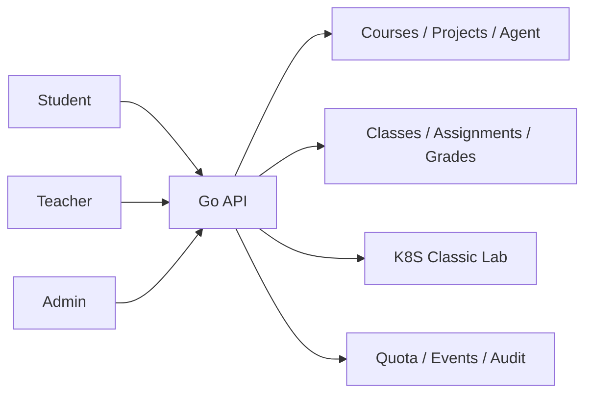

# Product Structure and Modules

Agent EDU Lab is a three-portal teaching platform for students, teachers, and administrators. Content production, hands-on learning, grading, and runtime governance share one Go and K8S architecture.

## Portal structure

## Student portal

- Learning center: courses, classes, tasks, notifications, outcomes, and continue-learning.
- Projects: search, tags, project detail, and unit progress.
- Classic Lab: desktop, web applications, terminal, command execution, and Agent verification.
- Assignments: submission, resubmission, evidence, feedback, and published grades.
- Agent learning: steps, chat, verification, FAQ, reflection, and interventions.

## Teacher portal

- Classes and member management.
- Course, project, Agent-manual, translation, and publishing workflows.
- Assignment resources, classes, deadlines, and submission rules.
- Rubric grading, return, reopen, and grade publication.
- Teaching workbench, risk students, progress, reminders, and Agent observability.

## Admin portal

- K8S sessions, logs, events, idempotent stops, and exposure risks.
- Lab templates and publishing audit.
- Class and assignment quality observation.
- Users, RBAC, settings, resource quotas, and system audit.

## Project rules

- Students see published projects only.
- Projects require an environment image or active Lab template.
- Project details and units enter `/lab`.
- Publishing checks validate structure, manuals, verification rules, and runtime configuration.
- Draft, archived, and retired historical projects cannot start a Lab through direct links.
