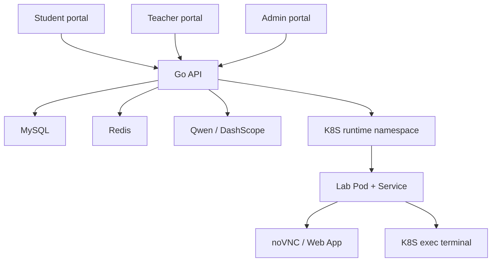

# Technology Ecosystem

Agent EDU Lab is built on a React frontend, a Go API, MySQL, Redis, K8S Classic Lab, and Qwen / DashScope. Courses and projects share one Lab runtime. The former TypeScript and Docker management stack is historical reference only.

## Stack

| Layer | Technology | Responsibility |
| --- | --- | --- |
| Frontend | React 18, TypeScript, Vite, HeroUI, Tailwind, Framer Motion | Student, teacher, and admin portals |
| API | Go, Gin, GORM, Casbin | Domain services, authorization, aggregation |
| Data | MySQL, Redis | Business data and token blacklist |
| Runtime | K8S client-go | Pods, Services, proxy, exec, janitor |
| AI | Qwen / DashScope | Chat, explanations, teacher-reviewed drafts |

## Topology

## Product boundaries

- `/study`: courses, classes, assignments, notifications, and outcomes.
- `/projects`: project list, detail, and units.
- `/lab`: the shared course and project practice workspace.
- `/teacher/*`: content, classes, assignments, grading, and observability.
- `/admin/*`: runtime governance, content governance, users, permissions, and settings.

## Runtime security

- Runtime Services use `ClusterIP` by default.
- noVNC and template web applications are available only through the Go same-origin proxy.
- `/ws/terminal` validates JWT, session ownership, and runtime state.
- `/api/lab/execute` reuses the same ownership checks.
- Dashboard exposure scans detect NodePort, LoadBalancer, external IP, Ingress, hostNetwork, and hostPort risks.

Production uses explicit SQL migrations from `EDU_Backend_Go/deployments/sql/`. Historical columns may remain for audit, but they are not current product contracts.
