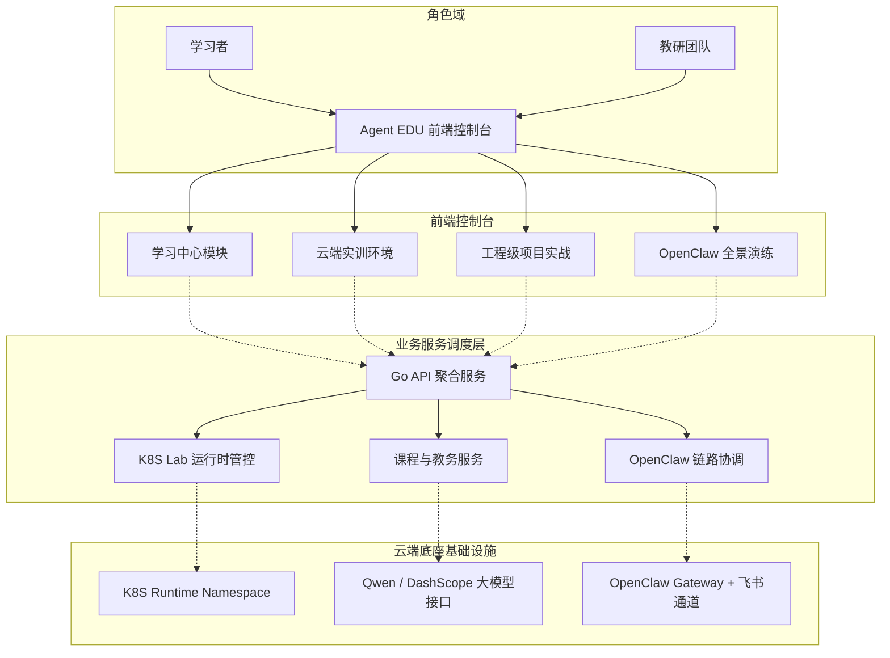

# 产品结构与功能模块

Agent EDU Lab 是面向 AI 智能体开发方向的教育实训平台，将课程学习、云端实验环境、AI 教师辅助和项目实战整合为统一闭环，帮助学习者从「看懂理论」到「独立完成工程任务」。

---

## 整体业务架构图

平台采用前后端分离的分层架构体系，从用户接入到基础设施共四个层级垂直打通：

---

## 九大功能模块全景

平台共包含九个核心功能模块，覆盖从内容展示到深度实训的完整教学链路：

| 模块 | 面向用户 | 核心能力 |
|:-----|:---------|:---------|
| **首页** | 所有访客 | 品牌价值传达、产品定位展示、课程与方案导航入口 |
| **学习中心** | 学生 | 技能树浏览 → 课程详情 → 阶段与课时展示，完整的结构化学习路径 |
| **理论课** | 学生 | Markdown / PDF / Word 多格式在线阅读 + AI 助教实时讲解 |
| **实训环境** | 学生 | 云端 Desktop / Terminal / IDE 一键拉起 + AI 步骤引导与验证 |
| **项目实战** | 学生 | 工程级多步交付项目，闯关驱动，联动实训环境 |
| **OpenClaw** | 学生 | Agent 工作流全生命周期可视化——从场景选择到成果交付 |
| **AI 广场** | 全员 | 主流 AI 模型、平台与工具生态的全景信息展示 |
| **个人中心** | 学生 | 学习档案、进度追踪、能力图谱、账户管理 |
| **管理后台** | 教师与管理员 | 课程创建与管理、用户权限管理、学情数据分析 |

---

## 核心业务模块拆解

### 结构化学习中心 (Study Hub)

学习中心是学生进入平台的第一站，也是整个学习旅程的导航中枢。它以技能树 + 课程路线图的形式，展示从入门到专精的完整学习路径。

**核心能力：**
- **技能树导航**：按 AI 技术方向组织技能节点，每个技能节点关联多门课程
- **结构化课程体系**：课程 → 阶段 → 课时三层嵌套，内容由浅入深递进
- **多模态文档引擎**：理论课支持 Markdown 实时渲染、PDF 翻阅预览、Word 文档解析
- **AI 助教伴学**：Go Agent 服务结合课时上下文和大模型能力，根据当前学习内容动态生成讲解、答疑和验证建议

### 云端一体化实训舱 (Cloud Lab)

完全消除本地环境配置的门槛——学生点击"启动实训"后，Go 后端会在 K8S runtime namespace 中创建预配置的 Pod / Service，并在浏览器内呈现由 Desktop、Terminal、IDE 组成的多标签云端工作区。

**核心能力：**
- **零配置启动**：一键创建包含完整开发工具的 K8S Lab 会话
- **多视图工作区**：远程桌面、命令行终端、在线代码编辑器一站式集成
- **AI 步骤驱动**：实训过程由 AI 教师逐步引导，每一步操作都有自动验证
- **WebSocket 终端桥接**：通过后端连接 K8S exec，支持实时终端操作和状态刷新

### 项目实战工作台 (Project Workspace)

区别于课时级别的技能训练，项目实战模块面向真实工作场景。每个项目由多个交付单元组成，采用「闯关驱动」的推进机制，按顺序完成各单元的工程任务。

**核心能力：**
- **工程级项目设计**：模拟企业中多步骤迭代交付的真实工作流程
- **单元闯关机制**：按序推进，前置单元未完成的不得跳过
- **环境直连**：普通项目单元可联动 Classic Lab 的 K8S 实训环境，在真实环境中编写和部署代码
- **整体进度追踪**：可视化项目完成度，记录每个单元的交付时间与质量

### 全局 AI 实景协同演练 (OpenClaw)

这是平台最具创新性和差异化竞争力的模块。OpenClaw 将一个真实的企业级 AI Agent 工作流完全透明化，从指令输入到思考过程再到工具调用执行，全链路实时可视、可观测、可参与。

**核心能力：**
- **四阶段全景演练**：场景选择 → 人机协作 → 可观测执行 → 成果交付
- **企业级 Agent 集成**：通过 OpenClaw Gateway 与飞书通道进行真实生产级交互
- **提示词工程引擎**：内置多种提示词增强策略，帮助学生优化指令质量
- **APM 级监控面板**：实时事件流、任务管线、技能调用图谱，模拟企业监控体验

---

## 三类用户的核心价值

### 对学生

- **零门槛启动**：无需配置本地环境，打开浏览器就能开始学习和动手实操
- **全程 AI 伴学**：课时感知的 AI 教师逐步引导操作，不容易因卡住而放弃
- **技能可量化**：每个步骤、每个项目都有自动验证，学习成果真实可衡量
- **工程经验积累**：完成项目实战后形成可展示的工程案例，为就业提供有力支撑

### 对教师

- **AI 代理重复答疑**：AI 助教处理 80% 以上的常规问题，教师聚焦核心辅导
- **课程结构化管理**：课程、阶段、课时、实训步骤全部可在后台灵活配置
- **教学可追踪**：学情数据面板实时展示学生进度、完成率、常见错误等关键指标
- **内容复用**：实训步骤和 AI 手册可跨课程复用，降低教学设计成本

### 对院校与机构

- **开箱即用**：平台化能力完整交付，大幅降低基础设施建设成本
- **数据安全**：支持私有化部署，教学数据和学生信息安全可控
- **可持续演进**：课程内容与工具生态持续扩展，平台能力随 AI 技术发展同步升级

---

## 平台竞争壁垒

| 对比维度 | 传统在线教育 | Agent EDU Lab |
|:---------|:-----------|:--------------|
| **学习方式** | 看视频，做选择题 | 理论 + 云端实操 + 项目实战，三位一体 |
| **AI 角色** | 无 / 通用聊天框 | 课时感知 AI 教师，主动引导 + 结果验证 |
| **环境准备** | 学生自行配置本地环境 | 云端一键拉起，零配置 |
| **实训质量** | 无法验证学生是否真的做了 | AI 步骤验证，确保操作正确完成 |
| **Agent 教学** | 无此能力 | OpenClaw 全生命周期可视化实训 |
| **效果评估** | 结业测试、在线选择题 | 过程代码检验，基于 K8S Lab 执行结果和 AST 分析的命令级验证 |
