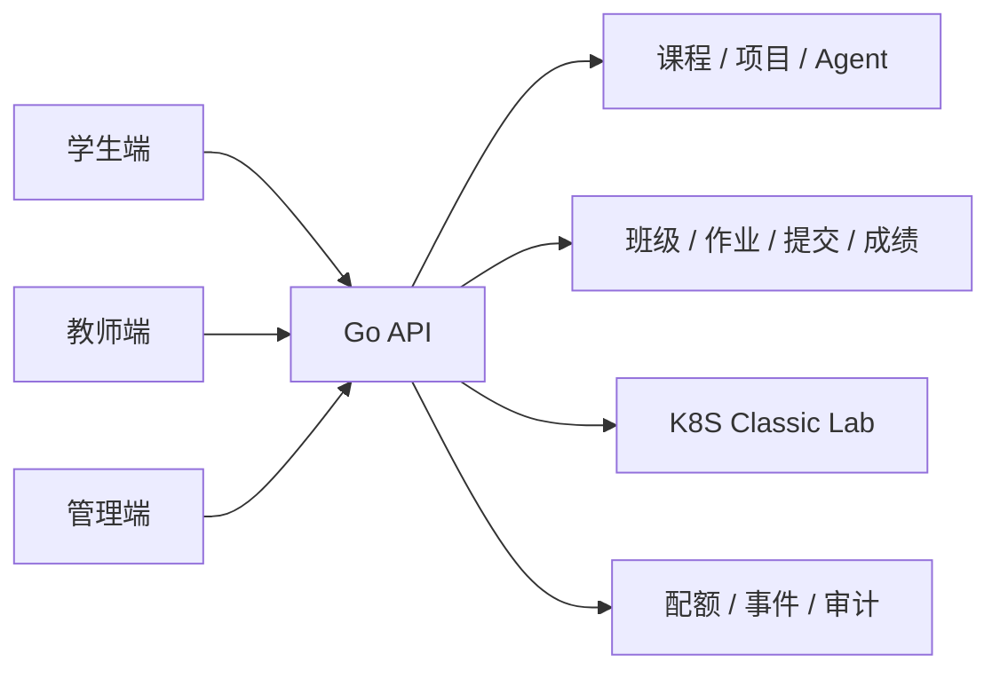

# 产品结构与功能模块

Agent EDU Lab 是学生、教师、管理员三端协同的实训教学平台。内容生产、学习实训、作业评分和运行治理围绕同一 Go + K8S 主线闭环。

## 三端结构



## 学生端

| 模块 | 主要能力 |
| --- | --- |
| 学习中心 | 课程、班级、任务、通知、继续学习、成果概览 |
| 项目实战 | 项目列表、标签筛选、项目详情、单元推进 |
| Classic Lab | 桌面、Web 应用、终端、命令执行、Agent 验证 |
| 作业与成绩 | 提交、重提、检查证据、教师反馈、已发布成绩 |
| Agent 教学 | 步骤内容、问答、验证、FAQ、复盘与干预提示 |

## 教师端

| 模块 | 主要能力 |
| --- | --- |
| 班级管理 | 学期、班级、成员导入、状态管理 |
| 内容生产 | 课程、项目、Agent 手册、翻译与发布检查 |
| 作业管理 | 资源绑定、班级发布、截止与重提规则 |
| 批改与成绩簿 | Rubric 评分、退回、重开、成绩发布 |
| 教学工作台 | 待办、风险学生、进度、提醒、Agent 观察台 |

## 管理端

| 模块 | 主要能力 |
| --- | --- |
| Dashboard | K8S 会话、日志、事件、幂等停止、暴露面风险 |
| 内容治理 | Lab 模板、发布审计、模板启停 |
| 教学观测 | 班级、作业质量和全局状态 |
| 系统治理 | 用户、RBAC、设置、资源配额和审计日志 |

## 项目实战规则

- 学生只看到已发布项目。
- 项目必须配置环境镜像或绑定启用中的 Lab 模板。
- 项目详情和项目单元统一进入 `/lab`。
- 教师发布前需要通过结构、手册、验证规则和运行时检查。
- 草稿、下架和历史类型项目不能通过直链启动环境。

## 产品闭环

```text
教师生产并发布内容
  -> 分配到班级作业
  -> 学生学习并进入 Lab
  -> Agent 验证与作业提交
  -> 教师批改 / 退回 / 发布成绩
  -> 学生查看反馈
  -> 管理端治理运行资源与审计
```
