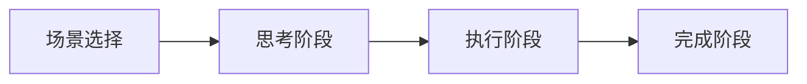

# 实训案例详解 — OpenClaw 全景演练

OpenClaw 是 Agent EDU Lab 平台中首个完整的 AI Agent 实训案例，也是平台最具创新性的旗舰功能模块。它让学生亲身体验一个真实企业级 AI 智能体从「接收指令」到「思考规划」到「工具执行」到「交付产物」的完整生命周期工作流。学生不是在看 PPT 或读文档，而是以**上帝视角实时观看 Agent 自动化决策的全过程**。

---

## 为什么需要 OpenClaw

传统的 AI 教学通常停留在理论层面：学生读完"Agent 是什么"的文章后，依然不清楚 Agent 到底是如何工作的。OpenClaw 的核心理念是——**让学生从"读 Agent"变为"参与 Agent"**。

### 教学价值

| 能力维度 | 在 OpenClaw 中的具体体现 |
|:---------|:-------------------------|
| **理解 Agent 工作原理** | 通过观察四个工作阶段，理解大模型如何把宽泛指令拆解为具体可执行步骤 |
| **掌握指令设计** | 亲手编写和优化指令，理解 Prompt 设计对执行效果的决定性影响 |
| **提示词工程实践** | 使用内置提示词增强引擎，实操多种增强策略（角色设定、思维链、输出格式约束等） |
| **工程化监控思维** | 实时查看执行日志、决策面板和技能调用图谱，培养云原生 APM 监控意识 |
| **产出质量评估** | 查看 Agent 交付的结构化产出物，学会从结果反向审视过程，建立质量评估能力 |

---

## 四阶段全景工作流

OpenClaw 将原本可能是黑盒的一次 API 请求，拆分为极其细腻的四个教学阶段，每个阶段都有明确的教学目的和交互设计：

---

## 阶段一：场景导入 — 打破输入阻塞

**教学目标：** 让学生了解 Agent 能处理哪些类型的任务，建立"场景 → 指令"的认知映射。

在这个阶段，系统以翻页式文件夹的 3D 发牌动效，展示多个预设的业务工作场景——例如"对一份研究报告做脱敏筛选"或"分析某项目的核心缺陷分布"等。这些场景来源于真实的企业工作需求，帮助学生理解 AI Agent 的实际应用边界。

**交互能力：**
- **场景卡片展览**：3D 翻页文件夹展示多个预设工作场景
- **场景详情预览**：每个场景附带简要说明和预期产出描述
- **一键启动**：选择场景后自动填充指令模板，无缝过渡到思考阶段
- **系统状态栏**：底部实时显示当前系统资源占用情况（CPU / 内存 / 网络）

---

## 阶段二：人机协作 — 深度思考交互

**教学目标：** 学生学习如何向 Agent 下达有效指令，并直观观察 Agent 的思考过程。

这是与 OpenClaw Agent 进行"脑域连接"的阶段。界面被分为左右两个交互区域：

| 区域 | 功能描述 |
|:-----|:---------|
| **左侧 · AI 对话区** | 与 OpenClaw Agent 实时对话，发送指令并查看 Agent 的思考回复 |
| **右侧 · 提示词引擎** | 提供多维度提示词增强工具，帮助优化指令质量 |

**提示词引擎核心功能：**
- **角色预设**：为 Agent 赋予特定身份（如代码审查专家、数据分析师）
- **思维链增强**：引导 Agent 进行分步推理，提升复杂任务的完成质量
- **输出格式约束**：指定 Agent 输出的格式规范（JSON、Markdown 报告等）
- **语境上下文**：为 Agent 补充必要的背景信息

**Premium 交互体验：**
- **流光 AI 头像 (AnimatedOrb)**：五色轨道旋转 + 色相动画的发光拟态球体，展示 Agent 活跃状态
- **Blur-Reveal 流式文字**：Agent 回复逐字从模糊到清晰渐显，模拟真实思考过程
- **弹性消息动画**：用户消息发送时带弹跳反馈效果
- **语音输入**：支持语音识别输入，实时波形可视化

**教学意义：** 学生亲手编写和优化指令，深刻理解 Prompt Engineering 的核心原则——好的指令决定好的执行结果。

---

## 阶段三：可观测执行 — 企业级监控体验

**教学目标：** 学生观察 Agent 如何将思考转化为行动，培养工程化的监控与调试思维。

传统大模型交互只有一个 Loading 转圈等待结果，但在 Agent 实操中，最重要的是知道它**在背后用什么工具干活、每一步在做什么**。这个阶段的界面被设计成极具企业科技感的 APM 大屏风格。

| 交互区域 | 功能描述 |
|:---------|:---------|
| **执行可观测区** | 实时事件日志流，按时间线展示每一个执行步骤和决策节点 |
| **任务执行管线** | 可视化展示任务步骤序列和当前执行进度 |
| **控制中心面板** | 运行状态、队列任务、执行进度百分比、活跃技能快照 |

**核心观测维度：**

1. **技能调用追踪**：实时显示 Agent 当前调用了哪些外部工具——网络爬虫、文件系统接口、代码执行器还是搜索引擎
2. **事件时间线**：按时间顺序打印每一次子任务分配、工具调用返回、异常捕获和自动重试
3. **管线追踪**：可视化展示任务编排引擎（Workflow）如何将一个大指令拆解为多个可执行的子步骤并依次消化

**面板设计：** 控制中心采用毛玻璃材质 + 渐变光晕设计，实时展示 Agent 的运行状态和资源消耗，模拟真实生产环境的 APM 监控体验。

---

## 阶段四：成果交付 — 质量评估与反思

**教学目标：** 学生查看 Agent 执行完成后的产出物，学会从结果反向审视过程，建立质量评估能力。

这个阶段等同于一次交付验收会议。Agent 的全部工作成果在这里集中呈现：

**交付内容：**
- **执行摘要**：一段话精炼总结 Agent 完成了什么工作、采取了哪些关键策略
- **产出物列表**：Agent 生成的结构化数据文件、分析报告、代码文件等，支持在线预览和下载
- **执行步骤回顾**：完整展示从开始到结束的每个步骤及其状态（成功 / 跳过 / 重试次数）
- **资源消耗统计**：本次任务消耗的计算资源、调用的工具数量和总耗时

---

## 技术创新亮点

### 全链路透明可视化

传统 Agent 教学只告诉学生"Agent 能做什么"，OpenClaw 让学生**亲眼看到 Agent 怎么做**。从指令发出 → 思考拆解 → 工具调用 → 中间产物 → 最终交付，全链路透明可观测。

### 飞书即时通讯集成

OpenClaw 通过飞书 Bot 通道与 Agent 进行交互。这不是一个模拟演示，而是真实的生产级技术方案——展示了 AI Agent 如何接入企业级即时通讯系统，通过消息队列进行指令传递和结果回传。

### 企业级监控面板

执行阶段的控制中心完全按照企业级 APM（Application Performance Management）的标准设计，让学生从实训阶段就建立起对分布式系统监控的直觉理解。

### Premium 级交互设计

每个阶段的 UI 交互都经过精心设计，从流光 AI 头像到 Blur-Reveal 流式文字，从弹性消息动画到音频波形可视化，确保学生获得沉浸式、高品质的学习体验。

---

## 学生的完整收获

完成一次 OpenClaw 全景演练后，学生将获得以下能力提升：

1. ✅ 理解 AI Agent 四阶段工作原理和内部决策逻辑
2. ✅ 掌握指令设计与提示词工程的核心方法论
3. ✅ 建立工程化的监控、调试和问题排查思维
4. ✅ 学会客观评估 Agent 执行质量和产出价值
5. ✅ 体验真实企业级 Agent 集成方案的工程实现

> OpenClaw 不是"看 Agent 的演示"，而是"参与 Agent 的工作"——这是 AI 实训教学的核心理念。
