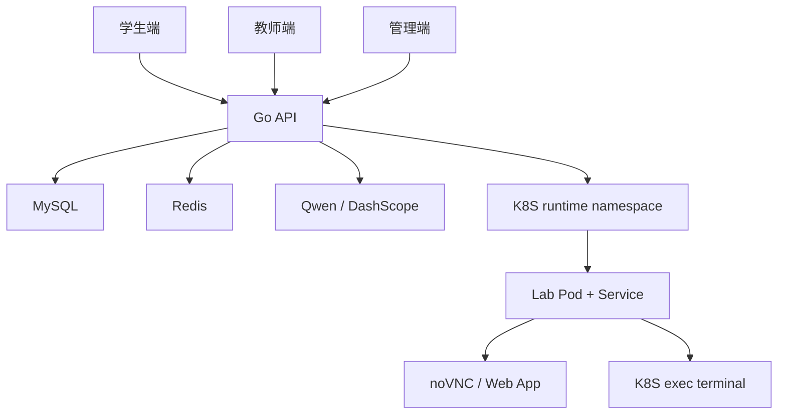

# 底层技术生态

Agent EDU Lab 当前由 React 前端、Go API、MySQL、Redis、K8S Classic Lab 和 Qwen / DashScope 组成。课程与项目共享同一 Lab 运行时，旧 TS + Docker 管理面只作历史参考。

## 技术栈

| 层 | 技术 | 责任 |
| --- | --- | --- |
| 前端 | React 18、TypeScript、Vite、HeroUI、Tailwind、Framer Motion | 学生、教师、管理员三端交互 |
| API | Go、Gin、GORM、Casbin | 领域服务、权限、聚合接口 |
| 数据 | MySQL、Redis | 业务数据、token blacklist |
| 运行时 | K8S client-go | Pod、Service、proxy、exec、janitor |
| AI | Qwen / DashScope | 问答、解释、教师辅助草稿 |

## 系统拓扑

## 前端边界

| 路由 | 责任 |
| --- | --- |
| `/study` | 课程、班级、作业、通知、学习成果 |
| `/projects` | 项目列表、详情与单元 |
| `/lab` | 课程和项目统一实训工作区 |
| `/teacher/*` | 内容生产、班级、作业、批改、成绩簿、观察台 |
| `/admin/*` | 运维治理、内容治理、用户、权限与设置 |

Services 层封装 HTTP 契约，页面组件不直接拼接多个后端数据源。弹窗和抽屉使用全局 Portal 公共组件。

## Go 领域边界

- `course / project / learning`：内容与学生学习主链路。
- `agent`：手册、步骤、问答、验证、FAQ 与复盘。
- `lab`：K8S 会话、代理、exec、停止与回收。
- `classroom / assignment`：班级、作业、提交、成绩和通知。
- `publishing`：发布门禁、Lab 模板和发布审计。
- `operations`：配额、运行事件和系统审计。

## Lab 网络与安全

- 运行 Service 默认使用 `ClusterIP`。
- noVNC 和模板 Web 应用只能经过 Go 同源代理。
- `/ws/terminal` 在握手时校验 JWT、会话归属和运行状态。
- `/api/lab/execute` 只接受受控会话 ID，并复用同一归属检查。
- Dashboard 扫描 NodePort、LoadBalancer、externalIPs、Ingress、hostNetwork 和 hostPort 风险。

## 数据与迁移

生产默认 `auto_migrate=false`，结构和数据变更通过 `EDU_Backend_Go/deployments/sql/` 显式迁移。历史字段可以为审计保留，但不得重新暴露为当前产品契约。
