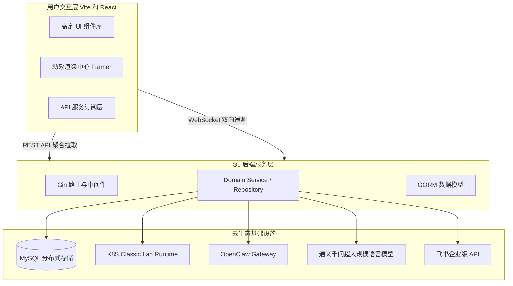
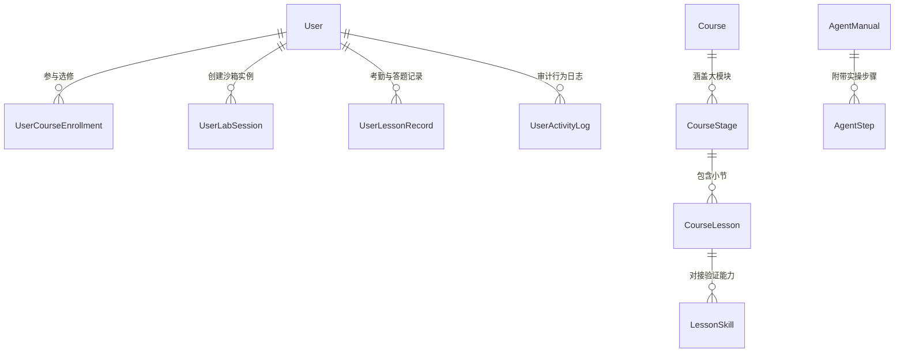
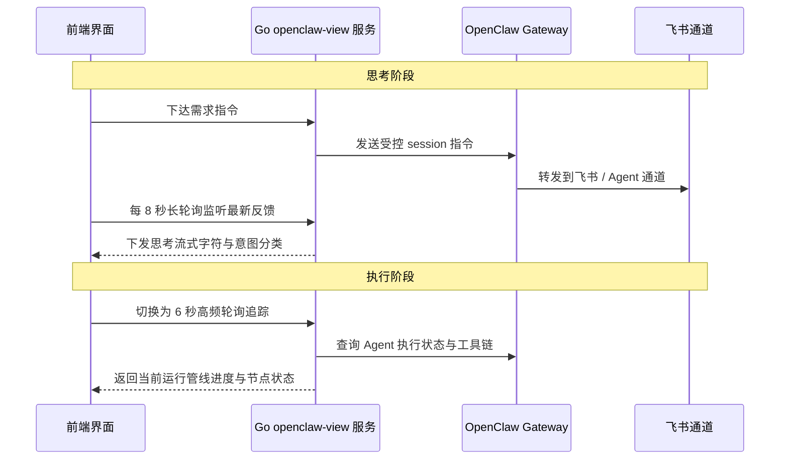

# 底层技术生态

Agent EDU Lab 的技术体系由前端 React 交互层、Go API 服务层、MySQL 数据库、K8S Classic Lab 运行时和 OpenClaw / AI 集成链路共同构成。本文档从架构设计、技术选型和数据模型三个维度，说明当前重构后的平台基础设施体系。

---

## 技术栈总览

| 层级 | 技术选型 | 版本 | 定位 |
|:-----|:---------|:-----|:-----|
| **前端框架** | React + TypeScript | React 18.x | 交互控制台核心 |
| **构建工具** | Vite | 5.x | 高速热更新开发工具链 |
| **UI/样式** | TailwindCSS + HeroUI | 3.x | 原子化样式 + 组件库 |
| **动画引擎** | Framer Motion + CSS Animations | — | Premium 级交互动效 |
| **后端框架** | Go + Gin | — | 当前主 RESTful API 服务层 |
| **ORM 框架** | GORM | — | 对象关系映射与数据库操作 |
| **数据库** | MySQL | 8.x | 结构化数据持久存储 |
| **AI 引擎** | Qwen / DashScope + Agent Prompt 编排 | — | 课时感知 AI、全局问答和教师 AI 草稿 |
| **IM 集成** | 飞书开放平台 + OpenClaw Gateway | — | OpenClaw Agent 通讯与视图数据来源 |
| **运行时编排** | Kubernetes | — | Classic Lab Pod / Service / exec / noVNC |

---

## 技术底座图解

整个平台技术由前端 React 交互层、Go API 服务、MySQL、K8S runtime 与 OpenClaw / AI 集成构成，共同组建稳固的地基：

---

## 前端架构设计

### 路由体系

前端采用 React Router 构建多级路由体系，核心路由如下：

| 路由路径 | 页面 | 功能说明 |
|:---------|:-----|:---------|
| `/` | 首页 Landing | 品牌展示、产品定位、方案入口 |
| `/study` | 学习中心 | 技能树浏览、课程列表、课程详情 |
| `/lesson/:id` | 理论课 | 多格式文档在线阅读 + AI 助教 |
| `/lab` | 实训环境 | 云端 Desktop / Terminal / IDE |
| `/projects` | 项目列表 | 工程级项目实战浏览 |
| `/openclaw/*` | OpenClaw | 四态全景演练路由 |
| `/ai-square` | AI 广场 | AI 模型与工具生态展示 |
| `/profile` | 个人中心 | 学习档案与账户管理 |
| `/admin` | 管理后台 | 课程管理、用户管理、数据分析 |

### 组件架构

前端组件按业务模块组织为 13 个子目录，遵循「组件内聚、服务分离」的设计原则。核心模块包括：

- **home/** — 首页各展示模块（Hero、Features、Ecosystem 等）
- **study/** — 学习中心与课程浏览
- **openclaw/** — OpenClaw 四态视图组件、聊天交互子组件（AnimatedOrb、流式 Markdown、音频波形等）
- **agent/** — 全局 AI 对话组件 AgentWidget
- **admin/** — 管理后台面板

### 服务层

独立的 Services 层封装所有 HTTP 请求和数据格式化逻辑，与组件层严格解耦，包括通用 API 封装、认证服务、课程数据服务、OpenClaw 数据服务等。

---

## 后端架构设计

后端采用经典的四层分离架构：**路由层 → 控制器层 → 服务层 → 数据模型层**，同时通过服务层横向对接多个外部基础设施。

### 核心服务矩阵

| 服务 | 职责 | 对接设施 |
|:-----|:-----|:---------|
| **CourseService** | 课程、阶段、课时的全生命周期管理 | MySQL |
| **LabService** | 实训环境的创建、启动、停止与资源回收 | K8S Pod / Service / exec |
| **AgentService** | AI 教师步骤管理、验证命令执行、进度推进 | Go Agent 服务 + K8S Lab |
| **OpenclawViewService** | OpenClaw 四态数据聚合（idle / thinking / executing / completed） | OpenClaw Gateway |
| **FeishuClient** | 飞书消息收发、事件回调处理 | 飞书 API |
| **QwenService** | 全局 Copilot 智能问答 | 通义千问 API |
| **TerminalService** | WebSocket 终端会话管理 | K8S exec bridge |
| **VerificationService** | 实训步骤验证（正则匹配、AST 分析、命令返回） | K8S Lab 命令执行 |

### 路由模块

Go 后端路由统一注册在 `EDU_Backend_Go/internal/router/router.go`，覆盖认证、用户、课程、项目、学习、作业、Agent、Classic Lab、OpenClaw 视图、K8S / OpenClaw / Feishu 健康检查与管理聚合等业务域。

---

## 数据实体网络拓扑

平台共包含 19 种不同层级的数据实体，形成紧密耦合的关系网络：

### 核心实体说明

| 实体 | 说明 |
|:-----|:-----|
| **User** | 用户主体，含角色（学生 / 教师 / 管理员）、头像、学习统计 |
| **Course** | 课程主体，含方向、难度等级、封面、简介 |
| **CourseStage** | 课程阶段（入门 / 进阶 / 实战），组织课时的中间层 |
| **CourseLesson** | 课时，最小学习单元，分为理论课和实训课两种类型 |
| **LessonMaterial** | 课时配套资料（Markdown / PDF / Word 格式） |
| **UserLabSession** | 用户实训会话，记录 K8S 会话、访问端口、运行状态、使用时长 |
| **AgentManual** | AI 教师手册，定义某课时的完整实训步骤序列 |
| **AgentStep** | 单个实训步骤，含描述文本、验证命令和期望输出 |
| **Project** | 项目实战主体，含多个交付单元 |
| **ProjectUnit** | 项目单元，可关联实训环境配置 |

### 核心数据流

- **课程域映射**：Course → Stage → Lesson → Material 组成严谨的课研内容标准链路
- **AI 共生映射**：AgentManual 与课时一一对应，每节实训课附带一组 AI 教师"说明书"
- **Lab 会话映射**：UserLabSession 代表用户为某次实训开辟的 K8S 云端工作空间，具有时效性和动态生命周期

---

## OpenClaw 微服务交互数据流

OpenClaw 当前是独立于 Classic Lab 的项目实战链路。Go 后端通过 `openclaw-view` 根据项目和单元派生受控 session key，并通过 OpenClaw Gateway / 飞书通道获取阶段、消息、事件和产物数据：

### 四态数据结构

- **IdleView（待机态）**：展示入口引导和可选任务场景
- **ThinkingView（思考态）**：包含飞书消息列表，展示 Agent 与用户的对话交互
- **ExecutingView（执行态）**：包含事件日志、工具链技能调用、当前状态、进度百分比和执行步骤
- **CompletedView（完成态）**：包含执行摘要、产出物附件和最终消息

---

## 外部依赖集成

| 外部服务 | 用途 | 接入方式 |
|:---------|:-----|:---------|
| **飞书开放平台** | OpenClaw Bot 消息通道 | REST API + Webhook 回调 |
| **OpenClaw Gateway** | OpenClaw session、阶段、事件和产物数据 | HTTP REST API |
| **通义千问 (Qwen)** | 全局 Copilot 智能问答 | OpenAI 兼容 API |
| **Kubernetes** | Classic Lab Pod / Service / exec / noVNC 运行时 | Kubernetes API |
