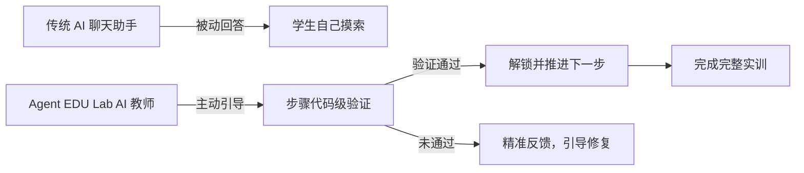
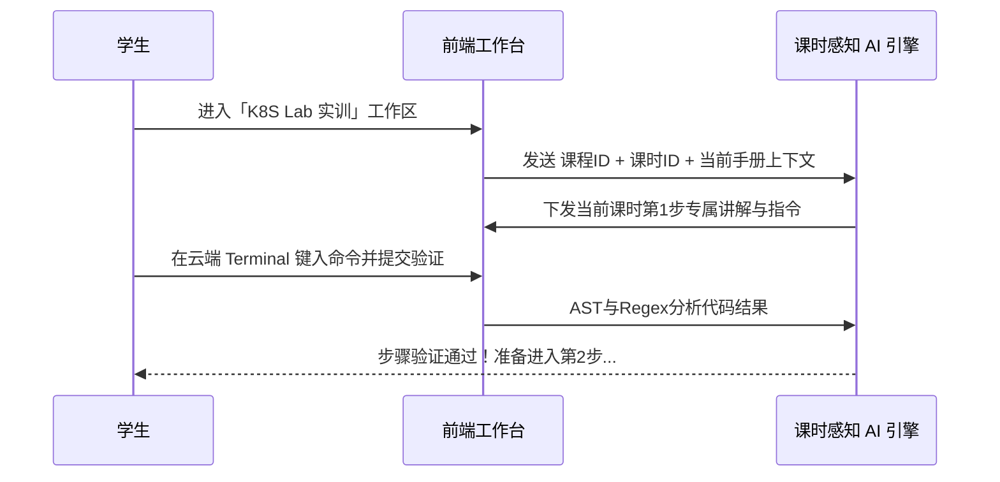

# 智能体实训交互设计

Agent EDU Lab 的核心差异化能力在于：AI 教师不是一个被动回答问题的"聊天框"，而是一个能够主动引导操作、实时验证结果、自动推进进度的**教学流程执行者**。本文档详细阐述 AI 智能体如何与实训环境深度协同，实现「可引导、可验证、可追踪」的教学闭环。

---

## 核心设计理念

传统在线教育中的 AI 助手与教学过程完全割裂——学生遇到问题时打开聊天框问一下，得到回答后再自行摸索。这种模式下，AI 只是一个"搜索引擎的替代品"。

**Agent EDU Lab 重新定义了 AI 在教学中的角色：**

AI 教师能做到三件传统在线教育做不到的事情：

1. **知道学生学到哪了** —— 感知当前课程、课时和具体步骤
2. **知道学生做对没有** —— 通过 K8S Lab 内的命令执行结果验证操作正确性
3. **能推动学生往前走** —— 验证通过后自动解锁下一步，验证失败则给出修复路径

---

## 智能体伴学双模式

平台设计了两种不同级别的 AI 介入模式，覆盖学习旅程中的各类场景：

### 模式一：全局答疑模式 (Copilot)

| 要素 | 说明 |
|:-----|:-----|
| **入口位置** | 全站右下角悬浮 AI 助手按钮 |
| **驱动引擎** | 通义千问（Qwen）大语言模型 |
| **知识来源** | 平台知识库 + 通用技术知识 |
| **适用场景** | 课前预习、概念理解、跨课程提问、编程答疑 |

全局 Copilot 不绑定具体课时上下文，像一位随时在线的技术顾问，回答学生在学习过程中遇到的各种通用问题。

### 模式二：实训引导模式 (Tutor)

| 要素 | 说明 |
|:-----|:-----|
| **入口位置** | 实训页面右侧 AI 教师面板 |
| **驱动引擎** | Go Agent 服务 + 大模型接口 + 课时上下文深度注入 |
| **知识来源** | 当前课时的 AgentManual + 步骤定义 + 验证规则 |
| **适用场景** | 实训课全程引导、操作验证、进度推进 |

这是平台的**核心竞争壁垒**——一个深度感知当前教学场景的专属 AI 教师，能够根据学生的实际操作情况提供精准、个性化的教学引导。

---

## 课时感知 AI —— 不同课时，不同教学

课时感知（Context-Aware）是平台最核心的 AI 创新之一。当学生进入不同的课时，AI 教师的教学内容会自动切换——这不是简单的关键词匹配，而是基于完整的课时上下文进行深度理解和内容生成。

**实现效果：** 每节课的 AI 教师内容完全不同。进入"Agent 工作流编排"课时，AI 教师会主动讲解工作流的概念和操作步骤；切换到"Agent 应用开发"课时，AI 教师会带领学生从零创建一个 Agent 应用。

---

## 云端实训环境 —— 零配置一键拉起

学生不需要在本地安装任何开发工具。点击「启动实训」，平台会通过 Go 后端在 K8S runtime namespace 中创建一个完整配置的 Lab 会话。

### 多标签云端工作区

学生在同一个浏览器窗口内，可以自由切换不同的工作视图：

| 标签页 | 技术实现 | 用途 | 典型场景 |
|:-------|:---------|:-----|:---------|
| **桌面 Desktop** | VNC 图形化连接 | 完整的远程桌面操作界面 | 操作 Dify 平台、浏览器类 GUI 应用 |
| **终端 Terminal** | WebSocket + K8S exec | 全功能命令行终端 | 执行命令、运行脚本、查看日志 |
| **编辑器 IDE** | Web 嵌入式 IDE | 在线代码编辑器 | 编写、调试和运行代码 |
| **Web 应用** | Lab 模板声明的同源代理 | 访问学生构建的服务 | 调试网页与接口产物 |

### K8S Lab 生命周期管理

- **动态分配**：按需创建 Pod / Service，高效利用集群资源
- **状态记录**：Go 后端记录会话、端口、运行状态和过期时间
- **终端桥接**：WebSocket 桥接到 K8S exec，支撑浏览器内命令行
- **超时清理**：TTL janitor 和清理任务回收过期或僵尸会话

---

## AI 教师 × 实训环境 联动闭环

这是平台最核心的差异化能力——AI 不只是在旁边"聊天"，而是和学生的实际操作环节深度绑定，形成「引导 → 操作 → 验证 → 推进」的教学闭环。

### 闭环工作流程

1. **AI 展示步骤**：AI 教师根据当前课时的实训手册，向学生展示需要完成的操作步骤
2. **学生实操**：学生在云端实训环境中按照指引执行操作
3. **提交验证**：学生完成操作后点击「已完成」按钮提交验证
4. **AI 验证**：系统在 K8S Lab 会话中执行预定义的验证命令，检查操作结果
5. **反馈处理**：
   - **验证通过** → 步骤标记完成，自动推进到下一步
   - **验证失败** → AI 教师解析错误信息，给出精准的修复建议
6. **循环推进**：所有步骤完成后，课时标记为已完成，更新学习进度

### 与传统教学的核心区别

| 环节 | 传统在线教育 | Agent EDU Lab |
|:-----|:-----------|:--------------|
| **教学引导** | 看视频自学 | AI 逐步引导操作 |
| **操作验证** | 无法验证 | AI 实时检查操作结果 |
| **进度推进** | 看完即完成 | 验证通过才算完成 |
| **卡住应对** | 自己搜索答案 | AI 精准反馈，引导重试 |
| **实训环境** | 本地配置（门槛高） | 云端一键启动（零门槛） |
| **教学效果** | 不可衡量 | 过程数据完整记录，可分析可追溯 |

---

## 产品价值总结

> **AI 教师不是一个"聊天工具"，而是一个"教学流程的执行者"。**

它将传统教育中教师的三个核心职能实现了数字化和自动化：

- **讲解** → 课时感知的智能讲解，每节课内容精准匹配
- **辅导** → 步骤化引导 + 错误诊断 + 修复建议
- **考核** → 基于容器命令级的自动化结果验证

这构成了 Agent EDU Lab 区别于所有传统 LMS（学习管理系统）和在线教育平台的**核心竞争壁垒**。
