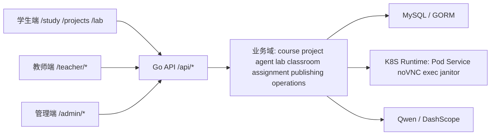

# Agent EDU Lab

Agent EDU Lab 是面向编程与 AI 智能体课程的实训教学平台。当前项目已经从早期 `TS 后端 + Docker 实验环境` 演进为 **Go 主后端 + K8S Classic Lab + 三端教学闭环** 的完整平台。

新会话不要从旧 Docker 管理面或旧 TS 路由开始判断当前事实。当前事实入口见 [docs/START-HERE.md](docs/START-HERE.md)，架构总览见 [docs/ARCHITECTURE.md](docs/ARCHITECTURE.md)。

## 当前平台形态



## 主能力闭环

- 学生端：课程学习、项目实战、Agent 步骤引导、Classic Lab、作业提交、成绩反馈、学习成果概览。
- 教师端：班级管理、课程 / 项目 / 手册内容生产、发布检查、作业发布、提交批改、成绩簿、教学过程工作台、Agent 观察台、AI 辅助草稿。
- 管理端：用户与班级观测、内容治理、作业质量观测、K8S 会话治理、资源配额、集成健康、审计日志、AI 能力开关。
- 实训运行时：课程和项目统一走 K8S Classic Lab，覆盖 Pod / Service / noVNC / WebSocket terminal / exec / stop / janitor。

## 技术栈

| 层 | 当前主线 |
| --- | --- |
| 前端 | React 18 + TypeScript + Vite + HeroUI + Tailwind + Framer Motion |
| 后端 | Go + Gin + GORM + Casbin + Redis token blacklist + MySQL |
| 实训运行时 | K8S client-go、Pod / Service、noVNC 代理、K8S exec terminal bridge |
| AI / 集成 | Qwen / DashScope |
| 旧实现 | `EDU_Backend/` TS 后端仅作历史契约与配置迁移参考 |

## 目录入口

- [AGENTS.md](AGENTS.md)：项目约束、编码边界、分层闭环完成标准。
- [docs/README.md](docs/README.md)：文档索引。
- [docs/PROJECT-STATUS.md](docs/PROJECT-STATUS.md)：当前已落地主链路与仍需收口项。
- [docs/REPO-MAP.md](docs/REPO-MAP.md)：仓库目录、主入口、历史目录边界。
- [EDU_Backend_Go/README.md](EDU_Backend_Go/README.md)：Go 后端启动、配置与模块说明。
- [EDU_Frontend/DESIGN.md](EDU_Frontend/DESIGN.md)：前端视觉与组件规范。

## 本地开发

### 前端

```bash
cd EDU_Frontend
npm run dev -- --host 0.0.0.0
```

- 默认地址：http://localhost:3000

### Go 后端

```bash
cd EDU_Backend_Go
go run ./cmd/server
```

- 本地 `.env` 默认覆盖到：http://localhost:4000
- 健康检查：http://localhost:4000/api/health
- 若未加载本地 `.env`，`configs/app.yaml` 中的样板端口仍保留为 `4002`。

## 验证命令

```bash
cd EDU_Backend_Go
go test ./...
```

```bash
cd EDU_Frontend
npm exec tsc --noEmit
```

## 开发边界

- 新能力优先进入 `EDU_Backend_Go/`，不要继续在 TS 旧后端堆新主链路。
- Classic Lab 当前以 K8S 为准，`/api/docker/*` 是遗留旧管理面语义。
- 项目实训统一从项目详情进入 `/lab`，不再按标签或项目类型分流运行时。
- 页面、工作台、管理页、业务模块都要先按 [feature-delivery-checklist.md](docs/feature-delivery-checklist.md) 列最小闭环，未覆盖闭环时只能称“首版主链路”或“展示层”。
- 不要把 `.env`、Qwen / DashScope 凭证或前端 `VITE_*TOKEN` 提交到 GitHub。

## 当前完成度表述

项目已经具备完整实训平台的主流程骨架与 M0-M7 首版主链路，但仍保留浏览器级全量回归、生产级成本账单、AI 运维与 prompt 治理等后续收口项。OpenClaw 产品模块已于 2026-07-14 下架，回滚源与数据策略见 [docs/OPENCLAW-RETIREMENT.md](docs/OPENCLAW-RETIREMENT.md)。除非对应验收项全部覆盖，文档和提交说明都应使用“已完成首版主链路”，不要直接写“模块已完成”。
