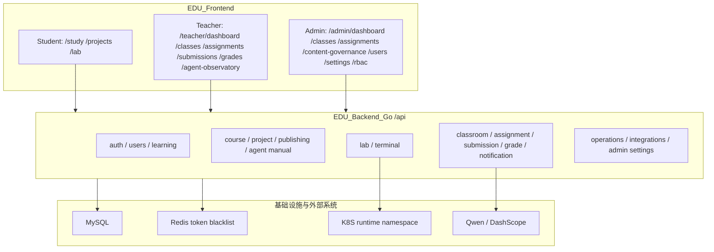

# Agent EDU 当前架构总览

最后更新：2026-07-14

本文档记录当前仓库真实主线。若与旧产品说明、旧 TS 后端文档、Docker 管理面说明冲突，以本文档、[PROJECT-STATUS.md](PROJECT-STATUS.md) 和 Go 后端路由为准。

## 1. 架构结论

- 当前主后端是 `EDU_Backend_Go/`，技术栈为 Go + Gin + GORM + MySQL + Casbin。
- 当前主前端是 `EDU_Frontend/`，技术栈为 React 18 + TypeScript + Vite + HeroUI + Tailwind。
- Classic Lab 已切换为 K8S 运行时：Pod / Service / noVNC proxy / WebSocket terminal / K8S exec / stop / janitor。
- 课程与项目实训统一使用 K8S Classic Lab，不再存在第二种项目运行时、标签分流或独立场景路由。
- 二阶段教学平台已按 M0-M7 形成首版主链路，覆盖班级、内容发布、作业、提交评分、教学工作台、运维治理、AI 助教。
- TS 后端 `EDU_Backend/` 只作为历史实现、配置迁移和契约对照来源。

## 2. 分层视图



## 3. 前端路由边界

| 入口 | 定位 | 当前说明 |
| --- | --- | --- |
| `/study` | 学生学习中心 | 课程、班级摘要、作业待办、通知、学习成果概览 |
| `/projects` | 学生项目实战 | 统一从项目详情和单元进入 Classic Lab |
| `/lab` | Classic Lab | 独立实训页面，连接 K8S Lab session、noVNC、terminal、Agent |
| `/teacher/*` | 教务端 | 班级、作业、批改、成绩簿、内容生产、Agent 观察台 |
| `/admin/*` | 管理端 | 运维、用户、班级、内容治理、作业观测、系统设置、RBAC |

前端弹窗、抽屉类组件应优先复用 `PageDialog`、`PageDrawer` 和全局 Portal，避免页面内直接写 `fixed inset-0`。

## 4. Go 后端领域模块

| 目录 | 责任 |
| --- | --- |
| `internal/domain/auth` | 登录、登出、refresh、JWT payload、token blacklist |
| `internal/domain/user` | 用户资料、管理员用户管理、学习者榜单 |
| `internal/domain/course` | 课程、阶段、课时、素材、技能、报名与进度 |
| `internal/domain/project` | 项目、单元、标签、学生可见性与历史类型防回流 |
| `internal/domain/learning` | 学习中心聚合、继续学习、学习成果 overview |
| `internal/domain/agent` | Agent 手册、步骤、AI 问答、验证、FAQ、复盘与学生侧干预读取 |
| `internal/domain/lab` | K8S Lab session、Pod / Service、noVNC proxy、exec、stop、janitor |
| `internal/domain/classroom` | 学期、班级、成员、主教师关系 |
| `internal/domain/publishing` | 发布检查、发布门禁、Lab 模板、发布审计 |
| `internal/domain/assignment` | 作业、提交、评分、成绩、通知、教师工作台、AI 建议、Agent 观察台 |
| `internal/domain/operations` | 资源配额、运行事件、系统审计 |

路由注册统一入口是 `EDU_Backend_Go/internal/router/router.go`。

## 5. 核心业务闭环

### 学生学习与实训

```text
登录 /study
→ 查看课程、班级、作业、通知和学习成果
→ 进入课程课时或项目单元
→ 打开 Agent 手册与步骤引导
→ 创建 K8S Classic Lab
→ 执行命令 / 验证步骤 / 保存进度
→ 提交作业
→ 查看教师反馈、成绩和重做入口
```

### 教师教学

```text
登录 /teacher/dashboard
→ 维护班级与学生
→ 创建课程 / 项目 / Agent 手册
→ 发布检查与学生视角预览
→ 发布作业到班级
→ 查看待办、风险学生和作业进度
→ 批改提交、退回、重开、发布成绩
→ 使用 AI 生成摘要 / 反馈草稿 / 薄弱点诊断
→ 在 Agent 观察台查看步骤热力、FAQ、干预和复盘
```

### 管理与运维

```text
登录 /admin/dashboard
→ 查看 K8S / 配置健康
→ 治理 Classic Lab 会话、日志、事件和幂等停止
→ 维护资源配额与 Lab 模板
→ 查看发布审计、作业质量、AI 设置和系统审计
```

## 6. Classic Lab 运行时

Classic Lab 当前主链路：

```text
POST /api/lab/create
→ 解析课程 / 项目 / 作业资源与 Lab 模板
→ 检查 M6 资源配额
→ 创建 K8S Pod / Service
→ 返回 noVNC / Web 应用 / terminal 所需 session 信息
→ /api/lab/execute 通过 K8S exec 执行验证命令
→ /ws/terminal 通过 K8S exec bridge 连接交互终端
→ POST /api/lab/stop/:sessionId 幂等停止与清理
→ janitor 回收过期 / 僵尸资源并写入审计
```

`/api/docker/*` 不再是当前主运行时目标。

## 7. 历史模块下架边界

- OpenClaw 产品模块已于 2026-07-14 下架，当前 React / Go 运行时不再提供对应页面、API、配置或健康检查。
- 下架前完整实现保存在远端分支 `codex/archive-openclaw-20260714`，不在 `main` 保留死代码。
- 历史项目和作业只归档，不自动转换为 Classic Lab；历史提交与会话列继续保留审计。
- 新项目只能按普通项目模型发布，并统一进入 `/lab`。
- 详细迁移、回滚和验收清单见 [OPENCLAW-RETIREMENT.md](OPENCLAW-RETIREMENT.md)。

## 8. 权限模型

- 角色继承固定为 `admin > teacher > student`。
- 学生主链路是 `/api/courses`、`/api/projects`、`/api/lab`、`/api/agent`、`/api/learning`、`/api/student/*`。
- 教师主入口是 `/api/teacher/*`，课程、项目、手册、班级、作业与 Agent 观察台均有归属过滤。
- 管理员主入口是 `/api/admin/*`，管理端可观测或治理全局资源。
- `/api/integrations/*` 保留兼容 alias，但默认只对管理员开放。

## 9. 数据与迁移

生产默认不依赖 GORM 自动改表，结构变更应配套 `EDU_Backend_Go/deployments/sql/` 迁移。

当前关键迁移包括：

- `20260422_teacher_admin_portal.sql`
- `20260422_m1_classroom.sql`
- `20260423_m2_content_publishing.sql`
- `20260423_m3_assignments.sql`
- `20260424_m4_submissions.sql`
- `20260424_m5_teaching_workbench.sql`
- `20260424_m6_operations.sql`
- `20260424_m7_ai_assistant.sql`
- `20260425_agent_teaching_v1.sql`
- `20260425_agent_teaching_v2.sql`
- `20260714_retire_openclaw.sql`（历史模块幂等下架，不删除审计证据）

## 10. 仍需收口

- 管理端复杂编辑链路仍需全量回归。
- M1-M7 多数模块已完成首版主链路，但浏览器级截图 / 录屏验收、深层审计、成本账单、AI 运维与 prompt 版本治理仍待后续阶段。
- `.env`、Qwen / DashScope 凭证不能提交到 GitHub；若需要共享配置，只能提交 `.env.example` 或脱敏部署说明。
