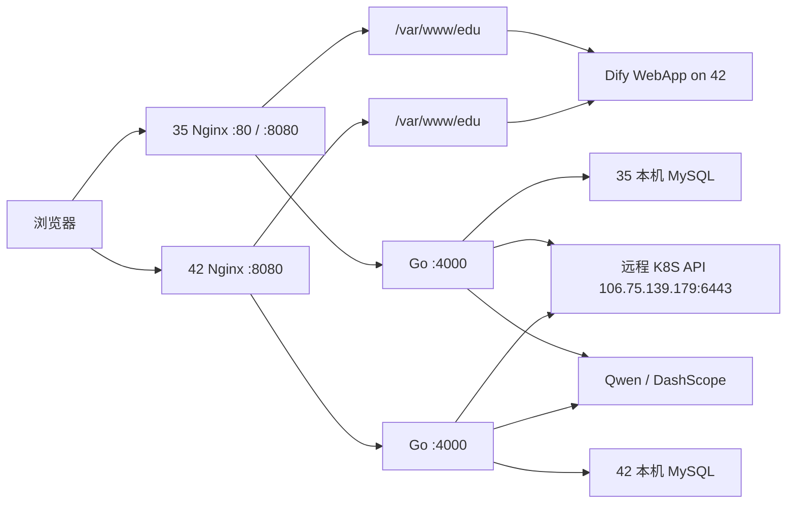

# Agent EDU 双服务器生产部署与增量更新手册

> 最后核对：2026-07-11。本文以 35、42 两台服务器的真实运行配置为准。
> 当前主链路是 React 前端 + Go 后端 + 本机 MySQL + 远程 K8S；旧 TS 后端、PM2、Docker Lab 文档不再作为生产依据。

快速入口：服务器清单见第 3 节，SSH 见第 4 节，前端更新见第 7 节，Go 更新见第 8 节，数据库见第 10 节，回滚见第 12 节，首次部署见第 15 节。

## 1. 安全规则

- 禁止在仓库、命令历史和本文记录 SSH 密码、数据库密码、JWT Secret、API Token、私钥正文。
- 两台服务器优先使用 SSH 公钥登录，不要把密码写进脚本或环境变量命令。
- 生产密钥只保存在服务器 `.env` 和 kubeconfig 中，权限应为 `600`。
- Dify Chatbot ID 放在本地被 Git 忽略的 `EDU_Frontend/.env.production.local`，不要提交真实值。
- 数据库迁移必须先备份，保持 `DATABASE_AUTO_MIGRATE=false`。
- 35、42 的入口端口和 K8S runtime namespace 不同，禁止互相覆盖 Nginx 或 `.env`。
- 42 同机运行其他系统，部署只操作本文列出的 Agent EDU 目录、站点和服务。

## 2. 当前拓扑



## 3. 服务器清单

| 项目 | 35 海外版 | 42 中文版 |
|---|---|---|
| SSH | `ubuntu@35.220.223.209:22` | `ubuntu@42.240.132.79:22` |
| 架构 | Linux `x86_64` | Linux `x86_64` |
| 时区 | `Etc/UTC` | `Asia/Shanghai` |
| Agent EDU 地址 | `http://35.220.223.209/`，也监听 `8080` | `http://42.240.132.79:8080/` |
| Nginx 站点 | `/etc/nginx/sites-enabled/edu` | `/etc/nginx/sites-enabled/edu` |
| 前端目录 | `/var/www/edu` | `/var/www/edu` |
| Go 工作目录 | `/var/www/edu-backend-go/current` | 同左 |
| Go 服务 | `edu-backend-go.service` | 同左 |
| Go 监听 | `0.0.0.0:4000` | `0.0.0.0:4000` |
| 数据库 | 本机 `edu_db_prod`，用户 `edu_app` | 本机 `edu_db_prod`，用户 `root` |
| MySQL 监听 | `127.0.0.1:3306` | `0.0.0.0:3306`，见安全注意项 |
| K8S namespace | `edu-backend-go-prod` | `edu-backend-go-prod` |
| Runtime namespace | `edu-runtime-overseas` | `edu-runtime-prod` |
| 前端备份 | `/var/www/edu-backups` | 同左 |
| 后端/DB 备份 | `/var/www/edu-backend-go/backups`、`db-backups` | 同左 |

42 的 `80` 端口还承载 Dify/其他站点，Agent EDU 必须使用 `8080`。35 的 Agent EDU Nginx 同时监听 `80`、`8080`，主入口使用 `80`。

## 4. SSH 连接

本机默认会尝试 `~/.ssh/id_ed25519`、`~/.ssh/id_rsa` 等标准私钥，当前两台机器均可使用公钥登录：

```bash
ssh ubuntu@35.220.223.209
ssh ubuntu@42.240.132.79
```

指定私钥：

```bash
ssh -i ~/.ssh/id_ed25519 ubuntu@35.220.223.209
ssh -i ~/.ssh/id_ed25519 ubuntu@42.240.132.79
```

如果 35 重装后出现 `REMOTE HOST IDENTIFICATION HAS CHANGED`，先从云平台或可信渠道核对新 ED25519 指纹，再更新本机记录：

```bash
ssh-keygen -F 35.220.223.209
ssh-keyscan -t ed25519 35.220.223.209 2>/dev/null | ssh-keygen -lf -
ssh-keygen -R 35.220.223.209
ssh ubuntu@35.220.223.209
```

不要为了省事长期使用 `StrictHostKeyChecking=no`。

## 5. 服务与配置位置

### 5.1 前端与 Nginx

- 静态产物：`/var/www/edu`
- Nginx 生效入口：`/etc/nginx/sites-enabled/edu`
- 42 日志：`/var/log/nginx/edu_access.log`、`/var/log/nginx/edu_error.log`
- 35 默认日志：`/var/log/nginx/access.log`、`/var/log/nginx/error.log`
- SPA 路由通过 `try_files $uri $uri/ /index.html` 回退。
- `/api/`、`/uploads/`、`/ws/` 代理到 `127.0.0.1:4000`。
- 42 还为 Lab proxy/gateway 配置了长连接与 3600 秒超时。

Nginx 配置修改后：

```bash
sudo nginx -t
sudo systemctl reload nginx
```

### 5.2 Go 后端

```text
/var/www/edu-backend-go/current/
├── edu-backend-go                 # Linux amd64 主二进制
├── schema-audit                   # 数据库结构审计工具
├── .env                           # 生产配置，禁止提交
├── .kube/remote-dev.yaml          # 远程 K8S 凭证，禁止提交
├── configs/
├── deployments/sql/
├── public/uploads/                # 用户上传，部署时必须保留
└── logs/
```

systemd 实际配置：

```text
/etc/systemd/system/edu-backend-go.service
WorkingDirectory=/var/www/edu-backend-go/current
ExecStart=/var/www/edu-backend-go/current/edu-backend-go
```

常用命令：

```bash
sudo systemctl status edu-backend-go --no-pager
sudo systemctl restart edu-backend-go
sudo journalctl -u edu-backend-go -n 100 --no-pager
sudo journalctl -u edu-backend-go -f
curl -fsS http://127.0.0.1:4000/api/health
```

### 5.3 运行配置边界

两台机器共同配置：

- Go：`0.0.0.0:4000`
- 数据库：`127.0.0.1:3306/edu_db_prod`
- 上传：`public/uploads`，公开前缀 `/uploads`
- kubeconfig：相对 Go 工作目录的 `.kube/remote-dev.yaml`
- K8S API：`https://106.75.139.179:6443`
- K8S context：`kubernetes-admin@kubernetes`
- Lab runtime：`PROJECT_LAB_RUNTIME=auto`
- Redis 当前禁用

应用服务器没有安装 `kubectl`。Go 通过 client-go 读取 kubeconfig 访问远程集群，所以“没有 kubectl”不代表 K8S 不可用。

只检查敏感变量名，不打印值：

```bash
sudo sed -n 's/^\([A-Za-z_][A-Za-z0-9_]*\)=.*/\1/p' \
  /var/www/edu-backend-go/current/.env | sort -u
```

重点变量类别：数据库 `DATABASE_*`/`MYSQL_*`、JWT、K8S、Qwen/DashScope、`SECURITY_ALLOWED_ORIGINS`。

### 5.4 Dify 构建配置

知识型课时右侧 Dify 按 locale 选择 Chatbot。本地配置文件被 Git 忽略：

```dotenv
# EDU_Frontend/.env.production.local
VITE_DIFY_BASE_URL=http://42.240.132.79
VITE_DIFY_CHATBOT_TOKEN_ZH=<中文公开 Chatbot ID>
VITE_DIFY_CHATBOT_TOKEN_EN=<英文公开 Chatbot ID>
```

这些变量在 `npm run build` 时写入静态 JS。只修改服务器 Go `.env` 不会改变 iframe，必须重新构建前端。

## 6. 发布前检查与干净工作树

```bash
git status --short --branch
git fetch origin main
git log -1 --oneline origin/main

REV=$(git rev-parse origin/main)
SHORT=$(git rev-parse --short "$REV")
BUILD_ROOT="$PWD/.runtime/deploy-$SHORT"
git worktree add --detach "$BUILD_ROOT" "$REV"
```

生产部署应基于已提交的 commit。存在其他未提交改动时必须使用干净 worktree，避免把实验代码打进生产。

完成部署后：

```bash
git worktree remove --force "$BUILD_ROOT"
```

## 7. 前端增量更新

适用于 React、CSS、i18n、Dify 配置等变更，无需重启 Go 或重载 Nginx。

### 7.1 构建

```bash
cp EDU_Frontend/.env.production.local \
  "$BUILD_ROOT/EDU_Frontend/.env.production.local"

cd "$BUILD_ROOT/EDU_Frontend"
npm ci
npm exec tsc --noEmit
npm run build

cd "$BUILD_ROOT"
COPYFILE_DISABLE=1 tar -czf "edu-frontend-$SHORT.tar.gz" \
  -C EDU_Frontend/dist .
shasum -a 256 "edu-frontend-$SHORT.tar.gz"
```

### 7.2 选择目标

35：

```bash
TARGET=ubuntu@35.220.223.209
PUBLIC_URL=http://35.220.223.209
```

42：

```bash
TARGET=ubuntu@42.240.132.79
PUBLIC_URL=http://42.240.132.79:8080
```

### 7.3 上传并原子切换

```bash
ARCHIVE="$BUILD_ROOT/edu-frontend-$SHORT.tar.gz"
scp "$ARCHIVE" "$TARGET:/tmp/edu-frontend-$SHORT.tar.gz"

ssh "$TARGET" "REV='$SHORT' bash -s" <<'REMOTE'
set -euo pipefail
stamp=$(date +%Y%m%d_%H%M%S)
archive="/tmp/edu-frontend-${REV}.tar.gz"
next="/var/www/edu-next-${REV}"
backup="/var/www/edu-backups/edu_before_${REV}_${stamp}"

sudo rm -rf "$next"
sudo mkdir -p "$next" /var/www/edu-backups
sudo tar -xzf "$archive" -C "$next"
test -f "$next/index.html"
sudo mv /var/www/edu "$backup"
sudo mv "$next" /var/www/edu
sudo chown -R www-data:www-data /var/www/edu
rm -f "$archive"
printf 'backup=%s\n' "$backup"
REMOTE

curl -fsS -o /dev/null -w '%{http_code}\n' "$PUBLIC_URL/"
curl -fsS "$PUBLIC_URL/api/health"
```

依次切换 `TARGET`/`PUBLIC_URL` 可发布两台；需求明确只发布一台时不要顺带更新另一台。

## 8. Go 后端增量更新

适用于 Go 代码变更且没有数据库结构变化的情况。

### 8.1 验证与交叉编译

```bash
cd "$BUILD_ROOT/EDU_Backend_Go"
gofmt -w path/to/changed.go
go test ./...

mkdir -p "$BUILD_ROOT/.artifacts"
GOOS=linux GOARCH=amd64 CGO_ENABLED=0 \
  go build -trimpath -ldflags='-s -w' \
  -o "$BUILD_ROOT/.artifacts/edu-backend-go" ./cmd/server
file "$BUILD_ROOT/.artifacts/edu-backend-go"
```

`file` 必须显示 Linux x86-64。上传 macOS Mach-O 二进制会导致 systemd 报 `Exec format error`。

### 8.2 上传、备份、替换、重启

```bash
TARGET=ubuntu@35.220.223.209  # 或 ubuntu@42.240.132.79
scp "$BUILD_ROOT/.artifacts/edu-backend-go" \
  "$TARGET:/tmp/edu-backend-go-$SHORT"

ssh "$TARGET" "REV='$SHORT' bash -s" <<'REMOTE'
set -euo pipefail
root=/var/www/edu-backend-go
stamp=$(date +%Y%m%d_%H%M%S)
backup="$root/backups/edu-backend-go_before_${REV}_${stamp}"

sudo mkdir -p "$root/backups"
sudo cp -a "$root/current/edu-backend-go" "$backup"
sudo install -m 0755 "/tmp/edu-backend-go-${REV}" \
  "$root/current/edu-backend-go"
rm -f "/tmp/edu-backend-go-${REV}"

sudo systemctl restart edu-backend-go
for _ in $(seq 1 20); do
  if curl -fsS http://127.0.0.1:4000/api/health >/dev/null; then
    exit 0
  fi
  sleep 1
done
sudo journalctl -u edu-backend-go -n 100 --no-pager
exit 1
REMOTE
```

如果还修改了 `configs/` 或 `deployments/`，单独同步对应目录。以下内容禁止进入 `rsync --delete` 范围：

- `current/.env`
- `current/.kube/`
- 回滚窗口内暂存的历史敏感文件
- `current/public/uploads/`
- `current/logs/`

## 9. 前后端完整更新

仓库已有干净构建脚本：

```bash
DEPLOY_STAGING_DIR="$BUILD_ROOT/.runtime/deploy-go-dist" \
DEPLOY_GOOS=linux DEPLOY_GOARCH=amd64 \
bash "$BUILD_ROOT/scripts/build-deploy-go.sh"
```

产物结构：

```text
.runtime/deploy-go-dist/
├── frontend/
├── backend/
│   ├── edu-backend-go
│   ├── schema-audit
│   ├── configs/
│   ├── deployments/
│   └── public/
└── REVISION
```

生产建议仍按本文第 7、8、10 节分步发布和验证。`scripts/deploy-go-prod.sh` 当前使用 `sshpass`/密码模式，且默认可能执行数据库修复 SQL；未审阅参数和迁移清单时不要直接对生产运行。

## 10. 数据库备份与迁移

两台服务器各自拥有独立 `edu_db_prod`。代码部署不会自动同步两边数据，也不应默认用 35 覆盖 42。

### 10.1 备份目标数据库

```bash
TARGET=ubuntu@TARGET_IP  # 将 TARGET_IP 替换为 35 或 42 的实际 IP
ssh "$TARGET" 'sudo bash -s' <<'REMOTE'
set -euo pipefail
cd /var/www/edu-backend-go/current
env_file=.env

env_value() { sed -n "s/^$1=//p" "$env_file" | tail -1; }
pick() {
  local key value
  for key in "$@"; do
    value=$(env_value "$key")
    if [ -n "$value" ]; then printf '%s' "$value"; return; fi
  done
}

db_host=$(pick MYSQL_HOST DATABASE_HOST)
db_port=$(pick MYSQL_PORT DATABASE_PORT)
db_user=$(pick MYSQL_USER DATABASE_USER)
db_password=$(pick MYSQL_PASSWORD DATABASE_PASSWORD)
db_name=$(pick MYSQL_DATABASE DATABASE_NAME)
backup_dir=/var/www/edu-backend-go/backups
backup="$backup_dir/${db_name}_$(date +%Y%m%d_%H%M%S).sql.gz"

mkdir -p "$backup_dir"
MYSQL_PWD="$db_password" mysqldump \
  --host="$db_host" --port="$db_port" --user="$db_user" \
  --single-transaction --routines --triggers "$db_name" | gzip > "$backup"
chmod 600 "$backup"
printf 'backup=%s\n' "$backup"
REMOTE
```

### 10.2 执行单个迁移

1. SQL 必须提交到 `EDU_Backend_Go/deployments/sql/`。
2. 先增量上传指定 SQL，再执行上一节备份。
3. 明确执行单个文件，禁止遍历整个目录盲跑。

```bash
TARGET=ubuntu@35.220.223.209  # 或 42
SQL_NAME=20260703_course_content_i18n_refine.sql

scp "$BUILD_ROOT/EDU_Backend_Go/deployments/sql/$SQL_NAME" \
  "$TARGET:/tmp/$SQL_NAME"

ssh "$TARGET" "sudo bash -s -- '$SQL_NAME'" <<'REMOTE'
set -euo pipefail
SQL_NAME=$1
cd /var/www/edu-backend-go/current
env_value() { sed -n "s/^$1=//p" .env | tail -1; }
pick() {
  for key in "$@"; do
    value=$(env_value "$key")
    if [ -n "$value" ]; then printf '%s' "$value"; return; fi
  done
}

db_host=$(pick MYSQL_HOST DATABASE_HOST)
db_port=$(pick MYSQL_PORT DATABASE_PORT)
db_user=$(pick MYSQL_USER DATABASE_USER)
db_password=$(pick MYSQL_PASSWORD DATABASE_PASSWORD)
db_name=$(pick MYSQL_DATABASE DATABASE_NAME)

MYSQL_PWD="$db_password" mysql \
  --host="$db_host" --port="$db_port" --user="$db_user" \
  "$db_name" < "/tmp/$SQL_NAME"
rm -f "/tmp/$SQL_NAME"
REMOTE
```

迁移后：

```bash
cd /var/www/edu-backend-go/current
sudo ./schema-audit
sudo systemctl restart edu-backend-go
curl -fsS http://127.0.0.1:4000/api/health
```

数据库恢复是高风险操作。先停止业务写入并再次备份当前库，再恢复指定 `.sql`/`.sql.gz`；不要因为代码回滚就自动回滚数据库。

## 11. 配置增量更新

### 11.1 Go `.env`

```bash
ssh ubuntu@TARGET_IP  # 将 TARGET_IP 替换为实际 IP
sudo cp -a /var/www/edu-backend-go/current/.env \
  /var/www/edu-backend-go/backups/env_$(date +%Y%m%d_%H%M%S)
sudoedit /var/www/edu-backend-go/current/.env
sudo chmod 600 /var/www/edu-backend-go/current/.env
sudo systemctl restart edu-backend-go
curl -fsS http://127.0.0.1:4000/api/health
```

不要用本地 `.env` 整文件覆盖服务器 `.env`，否则可能丢失数据库、K8S 或 AI 服务生产凭证。

### 11.2 kubeconfig 与历史凭证清理

仅在 K8S 凭证轮换时更新：

```text
/var/www/edu-backend-go/current/.kube/remote-dev.yaml
```

更新前备份，更新后 `chmod 600` 并重启 Go；禁止将内容打印到日志或提交到 Git。历史 OpenClaw / Feishu 凭证只在已批准的回滚窗口内保留，窗口结束后通过安全变更单独清理，不重新写回当前配置。

## 12. 回滚

### 12.1 前端

先列出备份并人工确认：

```bash
sudo find /var/www/edu-backups -maxdepth 1 -type d \
  -name 'edu_before_*' -printf '%f\n' | sort
```

```bash
BACKUP=/var/www/edu-backups/edu_before_COMMIT_TIMESTAMP
STAMP=$(date +%Y%m%d_%H%M%S)
sudo mv /var/www/edu "/var/www/edu-bad-$STAMP"
sudo mv "$BACKUP" /var/www/edu
sudo chown -R www-data:www-data /var/www/edu
```

### 12.2 后端

```bash
sudo systemctl stop edu-backend-go
sudo cp /var/www/edu-backend-go/backups/edu-backend-go_before_COMMIT_TIMESTAMP \
  /var/www/edu-backend-go/current/edu-backend-go
sudo chmod 755 /var/www/edu-backend-go/current/edu-backend-go
sudo systemctl start edu-backend-go
curl -fsS http://127.0.0.1:4000/api/health
```

## 13. 部署后验收

35：

```bash
curl -fsS -o /dev/null -w 'frontend=%{http_code}\n' http://35.220.223.209/
curl -fsS http://35.220.223.209/api/health
```

42：

```bash
curl -fsS -o /dev/null -w 'frontend=%{http_code}\n' http://42.240.132.79:8080/
curl -fsS http://42.240.132.79:8080/api/health
```

服务器内：

```bash
systemctl is-active nginx
systemctl is-active edu-backend-go
curl -fsS http://127.0.0.1:4000/api/health
sudo journalctl -u edu-backend-go -n 50 --no-pager
sudo nginx -t
```

浏览器至少冒烟：

- `/study`、课程详情、知识型 `/lesson/:id`
- `/lab` 的 Desktop、Terminal、WebIDE
- `/teacher/dashboard`、`/teacher/courses`
- `/admin/dashboard`
- 中英文切换及 Dify iframe
- 登录、上传、保存、完成实验、停止 Lab

## 14. 常见故障与运维提醒

### `Exec format error`

上传了 macOS 二进制；重新使用 `GOOS=linux GOARCH=amd64 CGO_ENABLED=0` 构建。

### 页面仍是旧版本

- 检查 `/var/www/edu/index.html` 时间和 JS 哈希。
- 强制刷新浏览器；42 的 `index.html` 已配置 no-cache。
- 确认实际访问 35 的 `80` 或 42 的 `8080`。

### API 502 / WebSocket 断开

```bash
sudo systemctl status edu-backend-go --no-pager
curl -v http://127.0.0.1:4000/api/health
sudo journalctl -u edu-backend-go -n 100 --no-pager
sudo nginx -t
```

### K8S/Lab 失败

- 检查 `.kube/remote-dev.yaml` 和文件权限。
- 核对两台不同的 `K8S_RUNTIME_NAMESPACE`。
- 测试应用服务器到 `106.75.139.179:6443` 的网络。
- 深入诊断可在 K8S 管理节点执行 `kubectl`，或临时安装客户端。

### 42 磁盘空间

2026-07-11 核对时 42 根盘使用率约 `84%`：

```bash
df -h /
sudo du -sh /var/www/edu-backups /var/www/edu-backend-go/backups \
  /var/www/edu-backend-go/current/logs
```

只删除已确认不再需要且已异地留存的旧备份，禁止未经筛选的通配符批量清理。

### 42 MySQL 暴露

42 当前监听 `0.0.0.0:3306`，应用实际使用 `127.0.0.1`。没有远程数据库依赖时，应将 MySQL `bind-address` 收紧到 `127.0.0.1`，并检查云安全组/UFW 禁止公网访问 3306；修改前先确认同机其他系统没有依赖。

## 15. 新服务器首次部署或灾难重建

本节用于新机器初始化。35、42 当前已经完成这些步骤，日常更新不要重复执行。

### 15.1 安装基础服务

生产机只运行构建产物，不需要安装 Node.js 或 Go：

```bash
sudo apt update
sudo apt install -y nginx mysql-server mysql-client ca-certificates curl rsync
sudo systemctl enable --now nginx mysql
sudo mkdir -p /var/www/edu /var/www/edu-backups
sudo mkdir -p /var/www/edu-backend-go/current
sudo mkdir -p /var/www/edu-backend-go/backups
```

### 15.2 初始化数据库

在 MySQL 控制台创建 `utf8mb4` 数据库和专用应用用户。密码使用密码管理器生成，不要出现在脚本或文档中：

```bash
sudo mysql
```

```sql
CREATE DATABASE edu_db_prod CHARACTER SET utf8mb4 COLLATE utf8mb4_unicode_ci;
CREATE USER 'edu_app'@'127.0.0.1' IDENTIFIED BY '<由密码管理器生成的强密码>';
GRANT ALL PRIVILEGES ON edu_db_prod.* TO 'edu_app'@'127.0.0.1';
FLUSH PRIVILEGES;
```

42 当前仍使用 MySQL `root`，重建时建议改成专用 `edu_app`，并同步调整 `.env`。

### 15.3 初始化 Go 配置与凭证

先按第 9 节生成完整部署包，再把后端初始文件上传到新服务器：

```bash
TARGET=ubuntu@TARGET_IP  # 将 TARGET_IP 替换为实际 IP
STAGING="$BUILD_ROOT/.runtime/deploy-go-dist"
rsync -az "$STAGING/backend/" "$TARGET:/tmp/agent-edu-backend/"

ssh "$TARGET" 'sudo bash -s' <<'REMOTE'
set -euo pipefail
mkdir -p /var/www/edu-backend-go/current
rsync -a /tmp/agent-edu-backend/ /var/www/edu-backend-go/current/
chmod 755 /var/www/edu-backend-go/current/edu-backend-go
rm -rf /tmp/agent-edu-backend
REMOTE
```

然后初始化 `.env` 和持久化目录：

```bash
cd /var/www/edu-backend-go/current
sudo cp .env.example .env
sudoedit .env
sudo chmod 600 .env
sudo mkdir -p .kube public/uploads logs
```

需要通过安全通道单独放置：

```text
.kube/remote-dev.yaml
```

文件设置 `chmod 600`。`.env` 至少配置数据库、JWT、K8S namespace/runtime namespace、上传目录、允许来源及实际启用的 AI 集成。

### 15.4 创建 systemd 服务

```bash
sudo tee /etc/systemd/system/edu-backend-go.service >/dev/null <<'SERVICE'
[Unit]
Description=Agent EDU Go Backend
After=network.target mysql.service
Wants=mysql.service

[Service]
Type=simple
User=root
WorkingDirectory=/var/www/edu-backend-go/current
ExecStart=/var/www/edu-backend-go/current/edu-backend-go
Restart=always
RestartSec=3
Environment=GIN_MODE=release

[Install]
WantedBy=multi-user.target
SERVICE

sudo systemctl daemon-reload
sudo systemctl enable --now edu-backend-go
curl -fsS http://127.0.0.1:4000/api/health
```

### 15.5 创建 Nginx 站点

以仓库 `deploy/nginx.conf` 为模板上传到 `/etc/nginx/sites-available/edu`：

- 35：监听 `80 default_server`，可同时监听 `8080`，`server_name _`。
- 42：监听 `8080`，`server_name 42.240.132.79`；不要占用已有 `80`。
- 保留 `/api/`、`/uploads/`、`/ws/` 和 Lab proxy/gateway 的反向代理及长连接配置。

```bash
sudo ln -sfn /etc/nginx/sites-available/edu /etc/nginx/sites-enabled/edu
sudo nginx -t
sudo systemctl reload nginx
```

首次前端发布使用第 7 节流程。

### 15.6 网络边界

- 对公网开放：SSH `22`；35 的 HTTP `80`（可选 `8080`）；42 的 Agent EDU `8080`。
- K8S API `106.75.139.179:6443` 只允许可信应用服务器来源。
- Go `4000` 应由 Nginx 访问，不应对公网开放。
- MySQL `3306` 默认只监听本机并由安全组/UFW 拒绝公网。
- 暂未配置 HTTPS 时浏览器会显示不安全；正式对外服务应增加域名、TLS 证书和 HTTP 到 HTTPS 跳转。

## 16. 发布原则

- 以 Git commit 为发布单位，生产机只接收构建产物，不直接改源码。
- 前端、后端、SQL、配置按变更类型增量发布，不做无意义全量覆盖。
- 切换前备份，切换后执行健康检查和浏览器冒烟。
- `.env`、上传目录、kubeconfig 和回滚窗口内保留的历史敏感文件永不进入 `rsync --delete` 范围。
- 两台机器的数据库、语言内容、Nginx 入口、runtime namespace 均为独立配置，不能默认互相覆盖。
