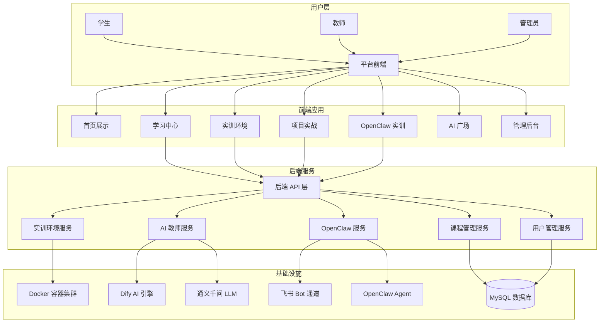
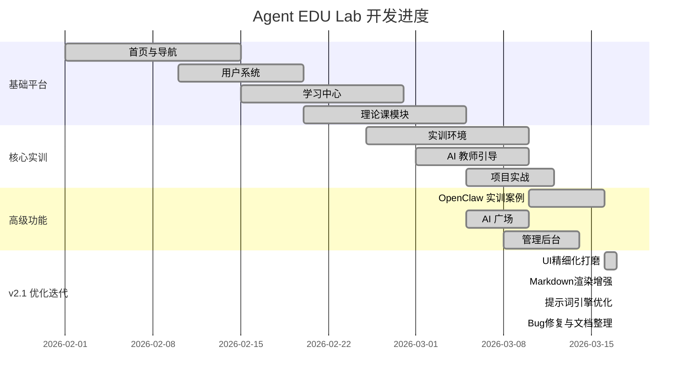

# Agent EDU Lab — 产品架构与功能模块

> **文档性质：** 领导汇报材料
> **版本：** v2.1 | 2026-03-17
> **定位：** 产品全貌概览，面向管理层快速理解平台能力与进展

---

## 一、平台定位

**Agent EDU Lab** 是面向 AI 智能体开发方向的**教育实训平台**，将课程学习、云端实验环境、AI 教师辅助和项目实战整合为统一闭环，帮助学生从「看懂理论」到「独立完成工程任务」。

**一句话价值：** 让 AI 教育不只是"看视频"，而是"做出来"。

---

## 二、整体架构

---

## 三、九大功能模块

| 模块 | 状态 | 面向用户 | 核心能力 |
|:-----|:----:|:--------|:---------|
| **首页** | ✅ 已完成 | 所有访客 | 产品定位展示、方案入口、市场价值传达 |
| **学习中心** | ✅ 已完成 | 学生 | 技能列表→课程详情→阶段/课时结构化浏览 |
| **理论课** | ✅ 已完成 | 学生 | Markdown/PDF/Word 资料阅读 + AI 助教动态讲解 |
| **实训环境** | ✅ 已完成 | 学生 | 云端 Desktop/Terminal/IDE 一键拉起 + AI 步骤引导 |
| **项目实战** | ✅ 已完成 | 学生 | 工程级项目→单元推进→实训环境直达 |
| **OpenClaw 实训** | ✅ 已完成 | 学生 | Agent 工作流全程可视化：场景→思考→执行→产出，Markdown 富文本渲染，企业级监控面板 |
| **AI 广场** | ✅ 已完成 | 全员 | 主流 AI 模型/工具生态全景展示 |
| **个人中心** | ✅ 已完成 | 学生 | 学习档案、进度记录、账户管理 |
| **管理后台** | ✅ 已完成 | 教师/管理员 | 课程管理、用户管理、学情数据 |

---

## 四、核心价值对比

| 对比维度 | 传统在线教育 | Agent EDU Lab |
|:---------|:-----------|:--------------|
| 学习方式 | 看视频，做选择题 | **理论 + 云端实操 + 项目实战** |
| AI 角色 | 无 / 通用聊天框 | **课程感知 AI 教师，主动引导 + 结果验证** |
| 环境准备 | 学生自行配置本地环境 | **云端一键拉起，零配置** |
| 实训质量 | 无法验证学生是否真的做了 | **AI 步骤验证，确保操作完成** |
| Agent 教学 | 无此能力 | **OpenClaw 全流程可视化实训** |

---

## 五、三类用户价值

### 对学生
- 不需要配环境，打开浏览器就能开始学
- AI 教师逐步引导，不容易卡住放弃
- 学完课程直接做项目，形成可展示的工程经验

### 对教师
- AI 助教处理重复答疑，聚焦核心辅导
- 课程结构化管理，教学可量化可追踪
- 实训步骤可复用，无需每次从头设计

### 对院校/机构
- 平台化能力开箱即用，降低基础设施成本
- 支持私有化部署，数据安全可控
- 课程内容与工具生态可持续扩展

---

## 六、当前开发进度

**当前状态：** 平台核心功能已全部开发完成，v2.1 优化迭代已交付，进入稳定运营与内容扩充阶段。

---

> *Agent EDU Lab — 让 AI 教育从「讲知识」升级为「练能力」的实训闭环平台。*
