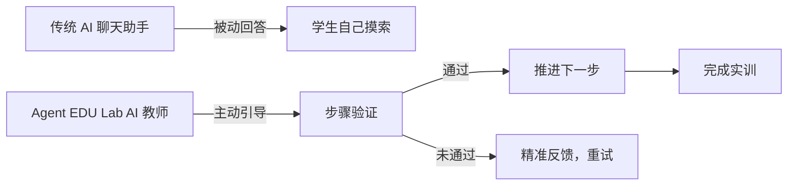
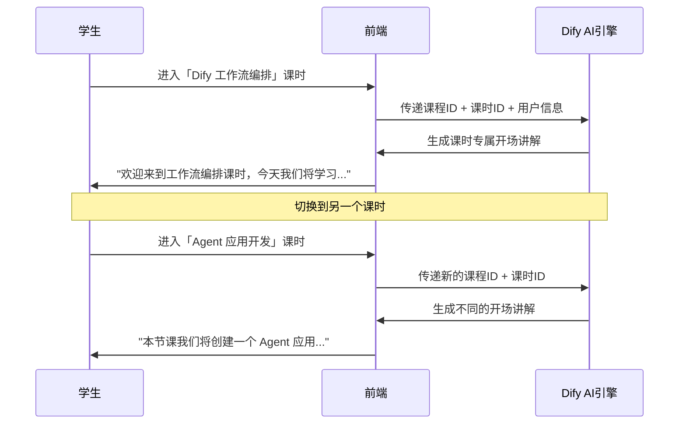
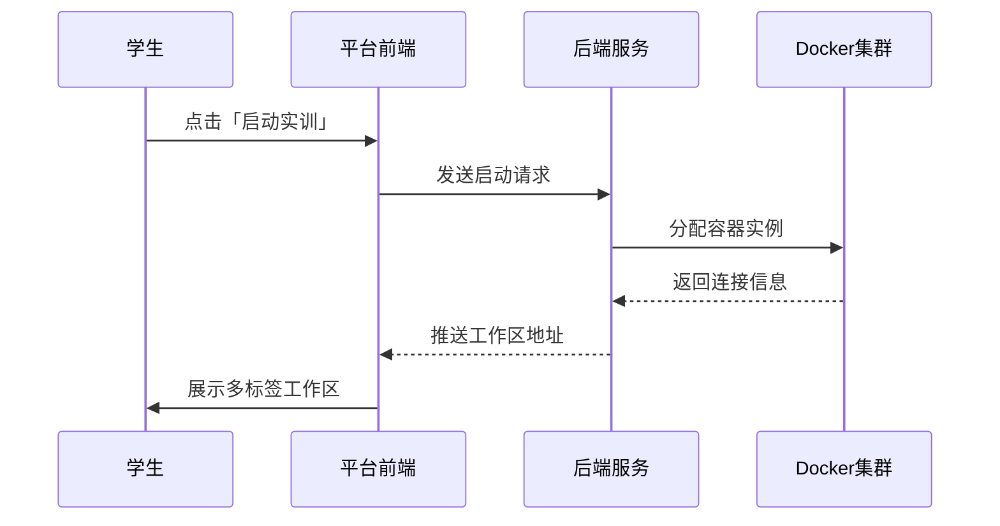
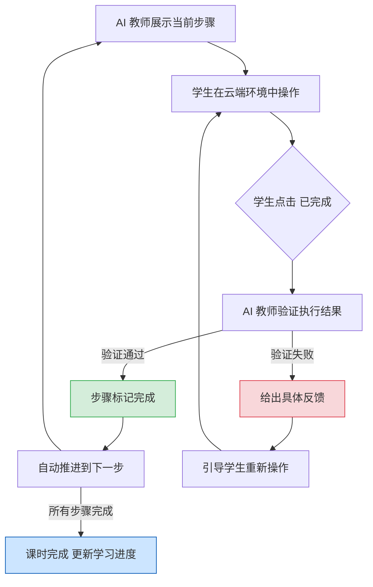

# Agent EDU Lab — 智能体 × 实训环境 交互设计

> **文档性质：** 领导汇报材料
> **版本：** v2.0 | 2026-03-16
> **定位：** 说明 AI 智能体如何与实训环境深度协作，实现「可引导、可验证、可追踪」的教学闭环

---

## 一、核心理念

传统在线教育中，AI 只是一个"聊天框"，和教学过程完全割裂。

**Agent EDU Lab 的 AI 教师不只是"能回答问题"，而是"能引导操作、能检查结果、能推进进度"。**

---

## 二、AI 教师的两种工作模式

### 模式一：全局对话模式

| 要素 | 说明 |
|:-----|:-----|
| 入口 | 右下角悬浮 AI 助手按钮 |
| 能力 | 基于平台知识库的智能问答 |
| 适用场景 | 课前预习、课后复习、跨课程提问 |
| 技术支撑 | 通义千问（Qwen）大语言模型 |

### 模式二：实训引导模式

| 要素 | 说明 |
|:-----|:-----|
| 入口 | 实训页面右侧 AI 教师面板 |
| 能力 | 步骤化引导→结果验证→进度推进 |
| 适用场景 | 课时实训全程引导 |
| 技术支撑 | Dify 工作流 + 课时上下文注入 |

---

## 三、课时感知 AI —— 不同课时，不同教学

这是平台最核心的创新之一。AI 教师能**感知当前课时**，动态调整教学内容。

**效果：** 每节课的 AI 助教内容不同，不是千篇一律的"你好，有什么可以帮你的"。

---

## 四、实训环境——云端一键拉起

学生不需要在自己电脑上安装任何东西。点击"启动实训"，平台自动分配一个完整的云端工作区。

### 多标签工作区

学生在同一个页面内，可以自由切换不同的工作视图：

| 标签 | 用途 | 适用场景 |
|:-----|:-----|:---------|
| **桌面 Desktop** | 图形化操作界面 | 操作 GUI 应用、Dify 平台 |
| **终端 Terminal** | 命令行终端 | 执行命令、查看日志 |
| **编辑器 IDE** | 在线代码编辑器 | 编写和调试代码 |
| **OpenClaw** | Agent 工作流视图 | 观察 Agent 执行全过程 |

---

## 五、AI 教师 × 实训环境 联动闭环

这是平台最核心的差异化能力——AI 不只是在旁边"聊天"，而是和学生的实际操作环节深度绑定。

### 与传统教学的核心区别

| 环节 | 传统在线教育 | Agent EDU Lab |
|:-----|:-----------|:--------------|
| 教学引导 | 看视频自学 | AI 逐步引导操作 |
| 操作验证 | 无法验证 | AI 实时检查操作结果 |
| 进度推进 | 看完即完成 | 验证通过才算完成 |
| 卡住应对 | 自己搜索答案 | AI 精准反馈，引导重试 |
| 实训环境 | 本地配置（门槛高） | 云端一键启动（零门槛） |

---

## 六、产品价值总结

> **AI 教师不是一个"聊天工具"，而是一个"教学流程的执行者"。**

它能做到三件传统在线教育做不到的事：

1. **知道学生学到哪了** —— 感知当前课时和步骤
2. **知道学生做对没有** —— 验证操作结果
3. **能推动学生往前走** —— 通过验证后自动推进

这构成了 Agent EDU Lab 区别于所有传统 LMS 和在线教育平台的**核心竞争壁垒**。

---

> *AI 教师 + 云端实训 = 「教学即服务」（Teaching as a Service）*
