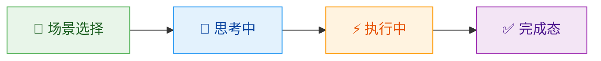
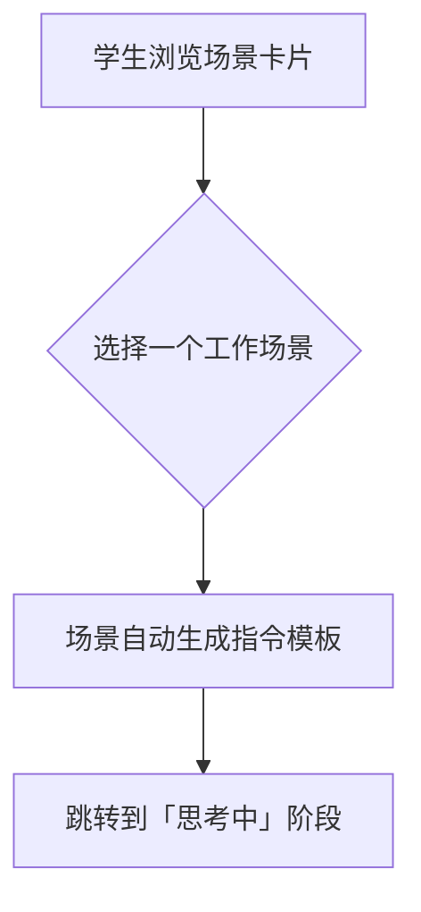
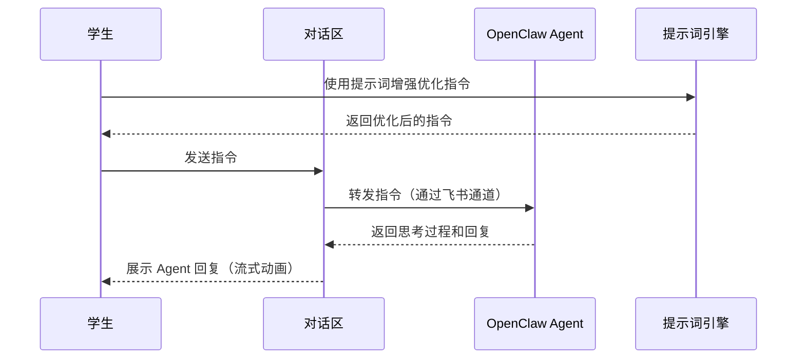
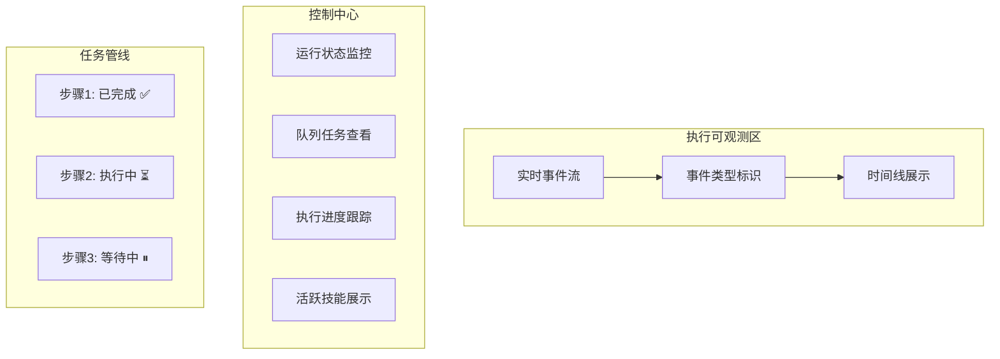
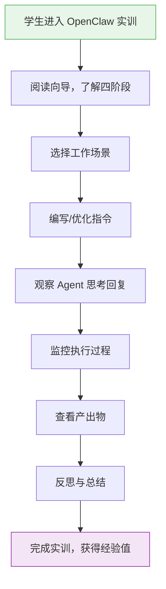

# Agent EDU Lab — OpenClaw 实训案例详解

> **文档性质：** 领导汇报材料
> **版本：** v1.1 | 2026-03-17
> **定位：** 详细说明 OpenClaw 作为 Agent 实训案例的产品设计、交互逻辑与教学价值

---

## 一、OpenClaw 是什么

**OpenClaw** 是 Agent EDU Lab 平台中首个**完整的 AI Agent 实训案例**。

它让学生亲身体验一个真实 AI 智能体从「接收指令」到「思考规划」到「执行任务」到「交付产出」的完整工作流程，不是看 PPT、不是读文档，而是**实时观看 Agent 工作的全过程**。

### 教学价值

| 维度 | 学生获得的能力 |
|:-----|:-------------|
| **理解 Agent 工作原理** | 通过观察四个阶段，理解 Agent 如何拆解任务、规划步骤 |
| **学会指令设计** | 亲手编写指令，理解 Prompt 设计对执行效果的影响 |
| **掌握提示词增强** | 使用提示词引擎，学会如何优化指令以获得更好结果 |
| **建立监控意识** | 实时查看执行日志和监控面板，培养工程化思维 |
| **形成完整认知** | 从输入到输出，建立 Agent 全链路知识体系 |

---

## 二、四阶段工作流

OpenClaw 实训的核心是一个清晰的**四阶段流程**，每个阶段都有明确的教学目的。

---

## 三、各阶段详解

### 阶段一：场景选择

**教学目的：** 学生了解 Agent 的任务类型，选择感兴趣的工作场景。

**界面能力：**
- **场景卡片展览**：以翻页文件夹的形式展示多个预设工作场景
- **一键启动**：选择场景后自动填充指令模板，进入下一阶段
- **底部状态栏**：显示当前系统资源占用（CPU / 内存 / 网络）

**教学意义：** 让学生理解 Agent 能处理哪些类型的任务，初步建立"场景→指令"的认知映射。

---

### 阶段二：思考中

**教学目的：** 学生学习如何向 Agent 下达指令，并观察 Agent 的思考过程。

**界面能力：**

| 区域 | 功能 |
|:-----|:-----|
| **左侧 · AI 对话区** | 与 OpenClaw Agent 实时对话，发送指令、查看回复 |
| **右侧 · 提示词引擎** | 提示词增强工具，帮助优化指令质量 |

**交互亮点：**
- **流光 AI 头像**：AnimatedOrb 动态头像，展示 Agent 活跃状态
- **流式文字动画**：Agent 回复逐字模糊浮现，模拟真实思考过程
- **语音输入**：支持语音识别，降低交互门槛
- **提示词增强引擎**：内置多种增强策略（角色设定、思维链、输出格式等）

**教学意义：** 学生亲手编写和优化指令，理解 Prompt Engineering 的核心——好的指令决定好的结果。

---

### 阶段三：执行中

**教学目的：** 学生观察 Agent 如何将思考转化为行动，培养工程化监控思维。

**界面能力：**

| 区域 | 功能 |
|:-----|:-----|
| **左侧 · 执行可观测区** | 实时事件日志、决策分析面板 |
| **右侧上 · 任务执行管线** | 可视化展示任务步骤和执行进度 |
| **右侧下 · 控制中心** | 运行状态、队列任务、执行进度、活跃技能 |

**教学意义：** 让学生不只是"等结果"，而是看到 Agent 执行的每一步，理解任务拆解、资源调度、状态管理等工程概念。

---

### 阶段四：完成态

**教学目的：** 学生查看 Agent 执行完成后的产出物，学会评估 Agent 工作质量。

**界面能力：**
- **执行摘要**：一段话总结 Agent 完成了什么
- **产出物列表**：文件下载、链接跳转等可交付产物
- **执行步骤回顾**：查看完整执行流程和每个步骤的状态

**教学意义：** 学生学会从"结果"反向审视"过程"，思考 Agent 的输出质量是否达标，哪些环节可以优化。

---

## 四、技术创新亮点

### 1. 全链路可视化

传统 Agent 教学只告诉学生"Agent 能做什么"，OpenClaw 让学生**亲眼看到 Agent 怎么做**。

从指令发出 → 思考过程 → 执行细节 → 最终产出，全链路透明可观测。

### 2. 飞书即时通讯打通

OpenClaw 通过**飞书 Bot 通道**与 Agent 交互，展示了 Agent 如何接入真实企业通讯系统——这不是模拟，是真实的生产级技术方案。

### 3. Premium 级交互体验

- **AnimatedOrb**：5 色轨道旋转 + 色相动画的流光球体，作为 AI 头像
- **Blur-Reveal 流式文字**：每个字从模糊到清晰逐渐显现
- **弹性消息动画**：用户消息发送时带弹跳效果
- **实时波形可视化**：语音输入时 24 柱状图实时显示音量

### 4. 企业级监控面板

控制中心采用白色圆角卡片 + 微阴影设计（去除边框线），实时展示 Agent 的运行状态、资源消耗、活跃技能，呈现企业级产品化视觉效果。

### 5. v2.1 新增特性

| 特性 | 描述 |
|:-----|:-----|
| **Markdown 富文本渲染** | 思考中对话 + 执行日志 Agent 回复支持表格、列表、标题、代码块等完整 GFM 渲染 |
| **Agent 回复折叠式展示** | 执行日志中 Agent 回复默认收起，点击「查看回复内容」展开 Markdown 渲染，避免页面拥挤 |
| **事件类型彩色标签** | 执行日志每个事件卡片带颜色编码的阶段标签（天蓝/琥珀/紫/翡翠绿） |
| **决策卡片企业化重构** | 去除边框线风格，改用白色圆角卡片 + 微阴影，内嵌灰底区块布局 |
| **提示词引擎增强** | 优化结果默认 Markdown 预览，支持编辑/预览切换，复制按钮带成功反馈 |
| **软件质量工程师提示词** | 全流程 Bug 修复提示词：缺陷评估→回归测试→修复方案→部署产物→飞书交付 |

---

## 五、教学流程总结

**学生的收获：**
1. ✅ 理解 Agent 四阶段工作原理
2. ✅ 掌握指令设计与提示词工程
3. ✅ 建立工程化监控与调试思维
4. ✅ 学会评估 Agent 执行质量
5. ✅ 体验真实企业级 Agent 集成方案

---

> *OpenClaw 不是"看 Agent 的演示"，而是"参与 Agent 的工作"——这是 AI 实训教学的核心理念。*
