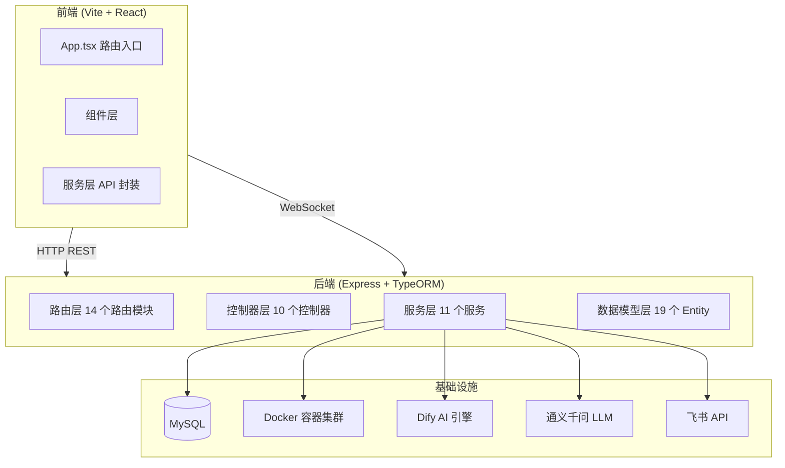
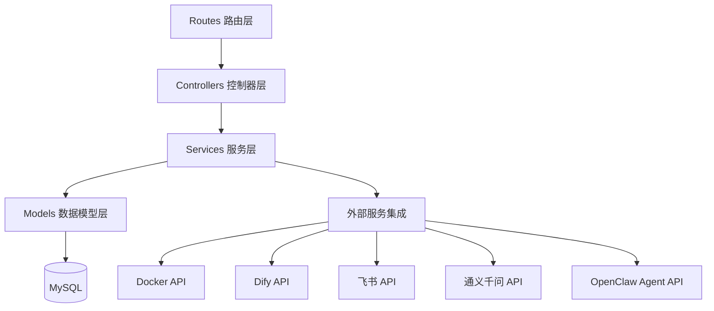
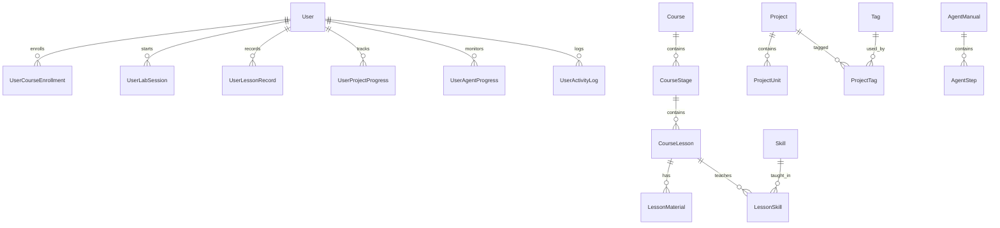
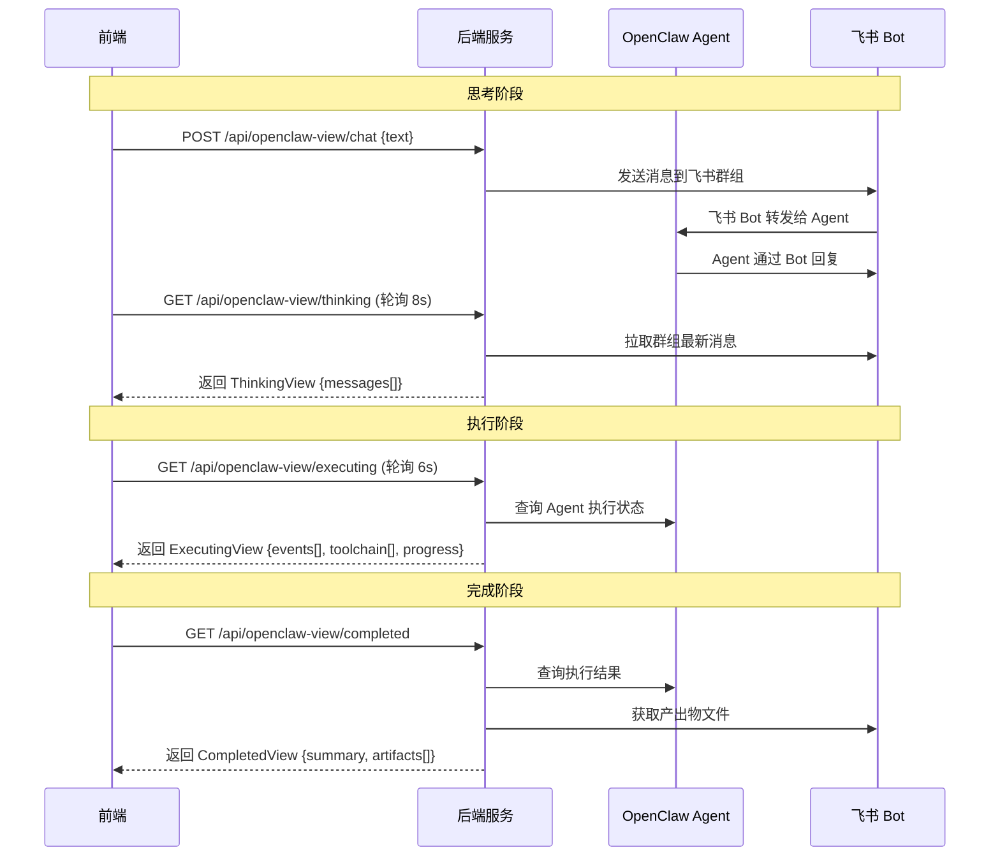
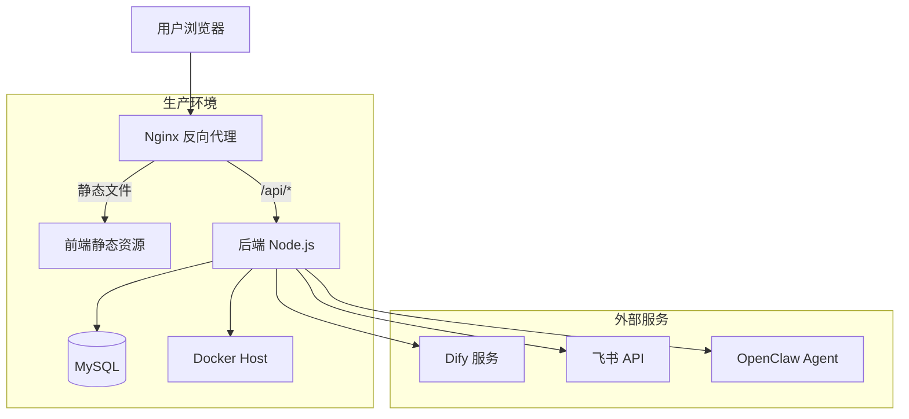

# Agent EDU Lab — 技术架构设计文档

> **文档性质：** 技术团队参考文档
> **版本：** v2.0 | 2026-03-16
> **面向：** 后端/前端开发、运维、架构评审

---

## 一、技术栈总览

| 层级 | 技术 | 版本 |
|:-----|:-----|:-----|
| **前端框架** | React + TypeScript | React 18.x |
| **构建工具** | Vite | 5.x |
| **样式方案** | TailwindCSS | 3.x |
| **UI 组件** | Lucide Icons + 自研组件库 | — |
| **动画** | Framer Motion + CSS Animations | — |
| **后端框架** | Express + TypeScript | Express 4.x |
| **ORM** | TypeORM | 0.3.x |
| **数据库** | MySQL | 8.x |
| **AI 引擎** | Dify（工作流）+ 通义千问（Qwen） | — |
| **IM 集成** | 飞书开放平台 SDK | @larksuiteoapi/node-sdk 1.59 |
| **容器化** | Docker + Docker Compose | — |
| **日志** | Winston | 3.x |

---

## 二、系统架构



---

## 三、前端架构

### 3.1 路由结构

```
/                          → HomePage（首页 Landing）
/login                     → LoginPage
/study                     → StudyPage（学习中心）
  /lesson/:id              → LessonPage（理论课）
  /lab                     → LabPage（实训环境）
/projects                  → ProjectList
  /projects/:id            → ProjectDetail
/ai-square                 → AISquare
/openclaw/*                → OpenClawPage（OpenClaw 四态路由）
  /openclaw/idle           → 场景选择
  /openclaw/thinking       → 思考中
  /openclaw/executing      → 执行中
  /openclaw/completed      → 完成态
/profile                   → ProfilePage
/admin                     → AdminPanel
```

### 3.2 组件目录

```
src/components/
├── admin/          # 管理后台
├── agent/          # AgentWidget 全局 AI 对话
├── ai-square/      # AI 广场
├── auth/           # 登录/注册
├── common/         # 通用组件 (Background, BackToTop)
├── guide/          # GuideHub 向导
├── home/           # 首页各模块 (Hero, Features, Ecosystem...)
├── layout/         # Navbar, Footer
├── openclaw/       # OpenClaw 实训模块
│   ├── chat/       # 聊天交互子组件
│   │   ├── AnimatedOrb.tsx       # 流光 AI 头像
│   │   ├── AnalysisWordSpan.tsx  # 逐字模糊浮现
│   │   ├── ChatMarkdownRenderer.tsx  # 流式 Markdown
│   │   └── AudioWaveform.tsx     # 语音波形
│   ├── OpenClawPage.tsx     # 主页面（路由 + 状态管理）
│   ├── OpenClawViews.tsx    # 四态视图组件
│   ├── OpenClawPanels.tsx   # 右侧面板组件
│   ├── PromptEnginePanel.tsx # 提示词引擎
│   ├── OpenClawGuide.tsx    # 使用向导
│   ├── constants.ts         # 常量
│   └── types.ts             # 类型定义
├── profile/        # 个人中心
├── project/        # 项目实战
├── study/          # 学习中心
└── ui/             # 通用 UI 组件
```

### 3.3 服务层

```
src/services/
├── api.ts             # 通用 API 封装 + OpenClaw API
├── auth.ts            # 认证服务
├── course.ts          # 课程 API
├── openclawView.ts    # OpenClaw 数据服务
└── ...
```

---

## 四、后端架构

### 4.1 分层结构



### 4.2 路由模块（14 个）

| 路由文件 | 前缀 | 职责 |
|:---------|:-----|:-----|
| `authRoutes.ts` | `/api/auth` | 用户认证（登录/注册） |
| `userRoutes.ts` | `/api/users` | 用户管理 |
| `courseRoutes.ts` | `/api/courses` | 课程 CRUD + 课时管理 |
| `skillRoutes.ts` | `/api/skills` | 技能查询 |
| `tagRoutes.ts` | `/api/tags` | 标签管理 |
| `projectRoutes.ts` | `/api/projects` | 项目管理 |
| `labRoutes.ts` | `/api/lab` | 实训环境管理 |
| `dockerRoutes.ts` | `/api/docker` | Docker 容器操作 |
| `agentRoutes.ts` | `/api/agent` | AI 教师交互 |
| `learningRoutes.ts` | `/api/learning` | 学习进度 |
| `uploadRoutes.ts` | `/api/upload` | 文件上传 |
| `openclawViewRoutes.ts` | `/api/openclaw-view` | OpenClaw 数据查看 |
| `integrationRoutes.ts` | `/api/integration` | 飞书集成回调 |

### 4.3 控制器（10 个）

| 控制器 | 核心方法 |
|:-------|:---------|
| `AuthController` | login, register, refreshToken |
| `UserController` | getUserInfo, updateProfile |
| `CourseController` | getCourses, getLessons, createCourse, updateLesson |
| `LabController` | startLab, stopLab, getStatus, verifyStep |
| `DockerController` | listContainers, createContainer |
| `AgentController` | chat, getSteps, verifyCompletion |
| `ProjectController` | getProjects, getProjectDetail |
| `OpenclawViewController` | getThinking, getExecuting, getCompleted, sendChat |
| `UploadController` | uploadFile |
| `TagController` | getTags |

### 4.4 服务层（11 个）

| 服务 | 职责 | 代码量 |
|:-----|:-----|:------:|
| `OpenclawViewService` | OpenClaw 三态数据聚合（思考/执行/完成） | 49KB |
| `CourseService` | 课程/阶段/课时管理 | 22KB |
| `OpenClawClient` | OpenClaw Agent HTTP 通信 | 20KB |
| `FeishuClient` | 飞书消息收发、事件回调 | 19KB |
| `LabService` | 实训环境生命周期管理 | 18KB |
| `TerminalService` | WebSocket 终端会话 | 16KB |
| `AgentService` | AI 教师步骤管理 | 13KB |
| `ProjectService` | 项目/单元管理 | 10KB |
| `VerificationService` | 实训步骤验证 | 5.5KB |
| `QwenService` | 通义千问对话 | 5.3KB |
| `UserService` | 用户账户 | 4.4KB |

### 4.5 数据模型（19 个 Entity）



**核心 Entity 说明：**

| Entity | 说明 |
|:-------|:-----|
| `User` | 用户（学生/教师/管理员），含角色、头像、学习统计 |
| `Course` | 课程主体，含方向、难度、封面、简介 |
| `CourseStage` | 课程阶段（入门/进阶/实战） |
| `CourseLesson` | 课时（理论课/实训课），含类型、时长 |
| `LessonMaterial` | 课时资料（Markdown/PDF/Word） |
| `Project` | 项目实战主体 |
| `ProjectUnit` | 项目单元（含实训环境配置） |
| `UserLabSession` | 用户实训会话（容器 ID、状态、时长） |
| `AgentManual` | AI 教师手册（实训步骤定义） |
| `AgentStep` | 单个实训步骤（描述、验证命令、期望输出） |

---

## 五、OpenClaw 技术实现

### 5.1 数据流架构



### 5.2 三态数据结构

```typescript
// 思考态
interface ThinkingView {
  messages: ThinkingMessage[];  // 飞书消息列表
}

// 执行态
interface ExecutingView {
  events: ExecutingEvent[];         // 事件日志
  toolchain: ExecutingToolchainSkill[];  // 工具链
  status: string;                   // 当前状态
  progress: number;                 // 进度百分比
  currentStep: string;              // 当前步骤
}

// 完成态
interface CompletedView {
  summary: string;                  // 执行摘要
  artifacts: CompletedArtifact[];   // 产出物
  finalMessages: CompletedFinalMessage[];  // 最终消息
}
```

### 5.3 前端状态管理

OpenClawPage 使用 URL 路由驱动状态，而非 useState：

```
/openclaw/idle       → sessionState = 'idle'
/openclaw/thinking   → sessionState = 'running'
/openclaw/executing  → sessionState = 'approval'
/openclaw/completed  → sessionState = 'completed'
```

每种状态触发不同的轮询策略：
- `thinking`: 每 8 秒轮询飞书消息
- `executing`: 每 6 秒轮询执行事件
- `completed`: 每 12 秒轮询产出物

### 5.4 外部依赖

| 依赖 | 用途 | 配置方式 |
|:-----|:-----|:---------|
| 飞书 App | Bot 消息通道 | `FEISHU_APP_ID`, `FEISHU_APP_SECRET`, `FEISHU_CHAT_ID` |
| OpenClaw Agent | AI 执行引擎 | `OPENCLAW_BASE_URL` |
| Dify | AI 教师工作流 | `VITE_DIFY_BASE_URL`, `VITE_DIFY_CHATBOT_TOKEN` |
| 通义千问 | 全局 AI 对话 | `QWEN_API_KEY` |

---

## 六、部署架构



**部署方式：** Docker Compose 一键部署，配置文件位于 `deploy/` 目录。

---

## 七、项目目录结构

```
ai-edu-agent/
├── EDU_Frontend/          # 前端代码
│   ├── src/
│   │   ├── App.tsx        # 路由入口
│   │   ├── components/    # 组件（13 个子目录）
│   │   ├── services/      # API 服务层
│   │   ├── styles/        # CSS（含动画）
│   │   ├── types/         # TypeScript 类型
│   │   └── lib/           # 工具函数
│   ├── package.json
│   └── vite.config.ts
│
├── EDU_Backend/           # 后端代码
│   ├── src/
│   │   ├── routes/        # 14 个路由模块
│   │   ├── controllers/   # 10 个控制器
│   │   ├── services/      # 11 个服务
│   │   ├── models/        # 19 个 Entity
│   │   ├── types/         # 类型定义
│   │   ├── middlewares/   # 中间件
│   │   ├── utils/         # 工具（logger 等）
│   │   └── config/        # 配置
│   └── package.json
│
├── deploy/                # 部署配置
├── knowledge-base-docs/   # AI 知识库文档
├── 课程手册/              # 课程内容
├── product_docx/          # 产品文档（本目录）
└── scripts/               # 脚本
```

---

> *技术服务于产品，架构服务于体验。*
